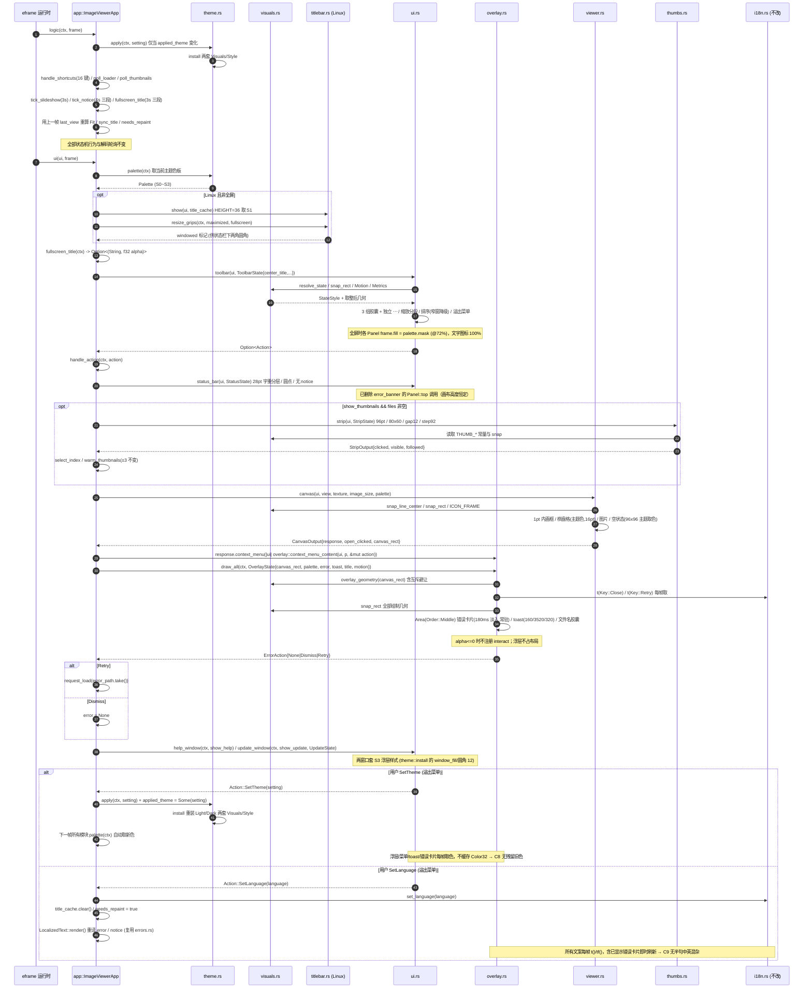
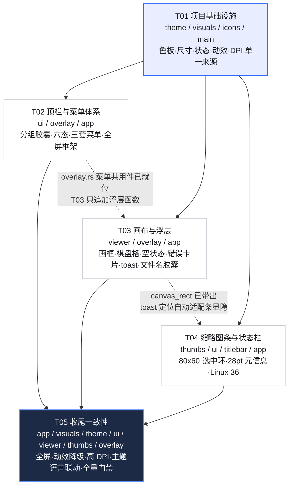

# image-view · UI 重设计增量系统架构设计与任务分解（redesign 分支）

> **增量架构文档**：只描述相对现状「版式 A」的 UI 层改动；未列出的一律保持现状。
> **上游输入**：`docs/UI-REDESIGN-PRD.md`（增量 PRD，596 行）、`README.md`、`design/redesign/README.md`、`Cargo.toml`、`apps/eframe-app/Cargo.toml`，以及 `apps/eframe-app/src/` 全部 13 个模块的真实源码。
> **本文不含完整函数体与代码实现**，只给命名、签名建议、模块边界、调用流程与可落地任务。
> **本阶段产出**：仅本文件一份新文档；不修改任何现有源码、PRD、设计稿、README、Cargo 清单。

---

## 0. 文档信息与结论速览

| 项 | 内容 |
| --- | --- |
| 文档语言 | 简体中文 |
| 角色 / 阶段 | 架构师高见远（Gao）· 增量系统设计 + 任务分解 |
| 技术栈 | **保持 Rust + eframe / egui 0.37 + glow**；不换框架、不新增 crate、不新增 Cargo 依赖、不新增后端 |
| 唯一可执行包 | `apps/eframe-app`（package `image-view`）；虚拟 workspace 13 crate，本次只动其 `src/` 下 UI 层文件 |
| 改动范围 | 仅视觉与自绘组件：色板、尺寸、图标、控件状态、菜单、画布画框、缩略图条、状态栏、浮层、全屏、动效、DPI 取整 |
| 用户决策 | Q1=是、Q2=是(56)、Q3=是(#2F6BFF/#5B8CFF)、Q4=否、Q5=是(80×60, MAX_SIDE 128 不变)、Q6=否、Q7=是(错误常驻)、Q8=否(复用现有键)、Q9=是(36)、Q10=否 |
| 验收依据 | PRD §5 ASCII 图与规格表 + §7 A/B/C/D 四组；不重绘效果图 |

### 0.1 结论：13 项 P0 能否在零回退边界内全部落地

**结论：能，13 项 P0 全部可在零回退边界内落地**，前提是遵守三条口径（详见 §9.3「零回退冲突回报」）：

1. **浮层一律不占布局**：错误卡片、toast、全屏文件名胶囊都用 `egui::Area` / `Painter` 叠加在画布 rect 之上，**不得**注册为 `Panel::top/bottom`（现状 `error_banner` 正是 `Panel::top`，是本期必须移除的推挤源）。
2. **零回退面不触碰**：`i18n.rs` 的 `Key` 枚举与中英资源表、`errors.rs` 的映射、`Settings` schema、`iv-gui-contract`（`Action`/`ToolbarState`）、`crates/*` 全部核心 crate、`Cargo.toml` 依赖树、`design/redesign/*`、`README.md` 一律不动；窄窗口宽度、全屏态、减少动效降级均用 `egui::Context` 每帧数据/常量路径承载，不新增状态字段到契约 crate、不新增设置项、不新增文案键。
3. **时长以「总时长不变」为准**：PRD §5.6/§5.9 的 toast `160/3400/320 ≈ 3.88s` 与 §6「短提示 ≈4s（改为渐隐但总时长不变）」存在 0.12s 数值张力 → 按零回退优先，保持 `NOTICE_DURATION = 4s` 总时长常量，内部三段切分为 `160 / 3520 / 320 = 4000ms`；全屏文件名保持 `FULLSCREEN_TITLE_DURATION = 3s`，内部三段 `200/2400/400`。PRD 的 3.88s 视为「≈4s」近似值。

**需明确回报主理人的 4 处数值/实现张力**（均不阻塞实现，口径已在本文固定）：

| # | 张力 | 零回退优先口径 | 涉及 P0 |
| --- | --- | --- | --- |
| R1 | toast 3.88s vs 「≈4s 总时长不变」 | 总时长保持 4.0s，三段 160/3520/320；渐隐无硬切 | P0-9 / P0-12 |
| R2 | 顶栏 56 + 状态栏 28 + 缩略图条 96 + Linux 标题栏 36 累加，与「分区之间不留 1px 缝隙」 | 各分区高度用 `visuals::snap()` 按 `ppp` 取整后累加；不新增 Panel | P0-13 / §5.10-7 |
| R3 | P0-10「错误卡片常驻」+ C9「切换语言后含已显示错误横幅立即刷新」 | 现状 `error: Option<String>` 存的是**已本地化文本**，语言切换不会重译；需用 `LocalizedText` 保存可重放源，绘制时每帧渲染 | P0-10 / C9 |
| R4 | 窄窗口降级(<720/<560)、全屏半透明、焦点环「仅键盘」都需要额外状态 | 一律从 `ui.ctx().screen_rect()`、`ui.ctx().input(viewport)`、`ctx.data_mut` 每帧读取，**不改 `ToolbarState`**（其定义在 `iv-gui-contract`，非 UI 层） | P0-2 / P1-1 / P0-11 / P0-4 |

### 0.2 单文档说明

架构师通用模板要求输出 `system_design.md` + 两份 `.mermaid`；本次遵循主理人「**本阶段只新增一个设计文档**」铁律，将类图（§4.2）、时序图（§5.1）、任务依赖图（§6.6）**全部内嵌于本文件**，不额外落盘。

---

## 1. 实现方案总述

### 1.1 现状每帧调用链（读码实测，改动必须落在其上）

`eframe::App` 实现位于 `app.rs::ImageViewerApp`：`logic()` 做状态机/解码轮询，`ui()` 做布局编排。

| 顺序 | `logic()`（`app.rs:933`） | `ui()`（`app.rs:986`） | 现状布局容器 |
| --- | --- | --- | --- |
| 1 | `theme::apply` 主题去重（`applied_theme`） | Linux: `titlebar::show` + `resize_grips` → `windowed` | `Panel::top`（HEIGHT 32） |
| 2 | `Caps::from_texture_side` / 恢复会话 / 拖放 | `fullscreen_title()` → `center_title: Option<(String,f32)>` | — |
| 3 | `handle_shortcuts`（16 键）/ `poll_loader` / `poll_thumbnails` | 构造 `ui::ToolbarState` → `ui::toolbar` → `Option<Action>` → `handle_action` | `Panel::top`（**52**） |
| 4 | `updater.poll` / `tick_slideshow` / `tick_notice` | `ui::error_banner(ui, &mut self.error, can_retry)` | **`Panel::top`（推挤画布）** |
| 5 | Fit 用上一帧 `last_view` 重算 / `sync_title` | 构造 `ui::StatusState` → `ui::status_bar` | `Panel::bottom`（**26**） |
| 6 | `needs_repaint` | `thumbs::strip(ui, StripState)`（条件：`show_thumbnails && files 非空`） | `Panel::bottom`（**88**） |
| 7 | — | `self.canvas(ui)` → `viewer::canvas`；右键 `output.response.context_menu` | `CentralPanel` |
| 8 | — | `ui::help_window` / `ui::update_window` | `egui::Window` |

关键事实：
- `ToolbarState` / `Action` 由 `pub use iv_gui_contract::{...}` 引入，**定义在 `crates/iv-gui-contract/src/lib.rs`（`ToolbarState` 13 字段、`Action` 19 变体）**，不在 `apps/eframe-app/src/` 内。→ 本期不改它，避免触碰非 UI 层 crate。
- `StatusState`（`ui.rs`）、`StripState`/`StripOutput`（`thumbs.rs`）、`CanvasOutput`（`viewer.rs`）都是 UI 层自有结构，可改。
- `theme::palette(ctx)` 每帧由 `ctx.theme()` 生成 `Palette`（`Clone, Copy`，24 字段）；全部模块每帧取色 → **主题切换天然即时生效**（C8）。
- `i18n::t()`/`tf()` 每帧取文案，但 `self.error` / `self.notice` 存的是**渲染后字符串** → C9 对已显示错误/提示的即时刷新需专门处理（见 §4.4）。
- `viewer::canvas` 已 `ui.allocate_rect(rect, Sense::click_and_drag())` 占满画布，`rect = ui.max_rect()` 即画布矩形 → 浮层可基于它绝对定位。

### 1.2 四级 elevation → 模块映射

| 层级 | PRD 语义 | 现有 Palette 字段（保留名、重新赋值） | 绘制模块 |
| --- | --- | --- | --- |
| S0 画布 | 恒深色、唯一内容面 | `canvas`、新增 `canvas_raised` / `checker_a` / `checker_b` | `viewer.rs::canvas` / `paint_rotated` / `draw_checkerboard` / `empty_state` |
| S1 框架 | 顶栏/缩略图条/状态栏/标题栏统一底色 | `chrome` = `strip` = `status`（**三者同值**）、`border`(结构边界) | `ui.rs::toolbar` / `status_bar`、`thumbs.rs::strip`、`titlebar.rs::show` |
| S2 控件面 | 胶囊/卡片/值块 | `control` = `tile`、`control_border` = `tile_border`、`track`(下沉面) | `ui.rs::icon_button` / `zoom_segment` / `checkbox`、`thumbs.rs` 卡片 |
| S3 浮层 | 菜单/toast/错误卡片/窗口 | **新增** `overlay`、`shadow`(四层)、`mask`(遮罩 @72%) | `overlay.rs`(新)、`ui.rs` 菜单/帮助/更新窗口 |

### 1.3 三个「单一真值来源」与复用方式

| 来源 | 落点 | 复用方式 | 理由 |
| --- | --- | --- | --- |
| **色板** | `theme.rs::Palette`（**扩展字段 + 重新赋值，不重命名**） | 各模块继续每帧 `theme::palette(ui.ctx())`；新增语义走新增字段 | 现有 24 字段被 5 个模块引用，**重命名会引发连锁改动**；重赋值即可让顶栏/状态栏/缩略图条/标题栏自动换成 S1 同值，改动面最小 |
| **尺寸 / 状态 / 动效 / DPI** | **新增 `visuals.rs`**：`pub const` 尺寸组 + `ControlState` 枚举 + `resolve_state()` + `Motion` 常量组 + `snap*()` | `ui.rs` / `viewer.rs` / `thumbs.rs` / `titlebar.rs` / `icons.rs` / `overlay.rs` 统一 `use crate::visuals` | PRD §9 约束 5「禁止散落硬编码色值/尺寸」；集中后 16 组合 DPI 矩阵只需改一处 |
| **图标** | `icons.rs::Icon` 枚举 + `paint()` | 所有按钮/菜单/浮层/空状态统一调用 `icons::paint(painter, Rect(18pt), Icon, color)` | 颜色由调用方按六态传入，图标本身不内置颜色（PRD §5.8） |

**状态矩阵复用**：`visuals::resolve_state(palette, ControlState, WidgetKind) -> StateStyle { bg, stroke, fg, radius }` 是唯一状态解析器；`icon_button` / `zoom_segment` / `sort_button` / 卡片 / 菜单项 / 复选 / 单选 / 主按钮全部经它取色，杜绝现状 `hovered || active` 共用同一底色（P-2）。

### 1.4 浮层叠放与「画布可用高度恒定」的实现约束（**核心**）

egui 立即模式下 `TopPanel`/`BottomPanel` 会从可用矩形中**切走条带**，只有 `CentralPanel` 拿到剩余；任何注册为 Panel 的元素都会改变 `CentralPanel` 的 `max_rect`，即改变画布可用高度与 `view.last_view`（进而影响 Fit 百分比语义）。因此：

| 约束 | 规定 |
| --- | --- |
| C-1 | **删除 `ui::error_banner` 的 `Panel::top` 实现**；错误卡片迁移到 `overlay.rs::error_card`。`app.rs::ui` 不再在 `toolbar` 与 `status_bar` 之间调用它 |
| C-2 | 三类画布浮层（错误卡片 / toast / 全屏文件名胶囊）由 `app.rs::ui` 在**所有 Panel 与 `CentralPanel` 之后**统一调用 `overlay::draw_all(ctx, OverlayState)`；用 `egui::Area::new(Id::new("canvas_overlays")).fixed_pos(canvas_rect.min)`（**默认 `Order::Middle`**），`Area` 不参与布局切分 |
| C-3 | 画布矩形通过 `viewer::CanvasOutput` **新增 `canvas_rect: Rect`** 字段带出（`canvas()` 内已有 `rect = ui.max_rect()`），`app.rs` 收集后传给 `overlay`；**不得**用 `ctx.available_rect()` 猜测（会被后续 Window 干扰） |
| C-4 | 浮层坐标全部相对 `canvas_rect`（画布底边恰为缩略图条/状态栏顶边，故 toast「距下方分区 12」= `canvas_rect.max.y - 12`，无需感知条显隐）；见 §8.4 |
| C-5 | 浮层交互按钮用 `ui.interact(rect, Id, Sense::click())` 建立绝对命中区；**alpha ≤ 0 或浮层不可见时不注册任何 interact**（PRD §5.9-5，避免不可见控件拦截画布点击/拖拽） |
| C-6 | 叠放顺序：**S0 画布 < S1 框架 < S2 控件 < 画布浮层(Area/Middle) < egui 菜单/右键菜单/Window(Foreground)**。菜单交给 egui 原生层，浮层不与菜单抢 `Order::Foreground` |
| C-7 | 错误卡片与全屏文件名胶囊都锚在画布顶部 → **互斥避让**：错误卡片存在时文件名胶囊下移 `error_card.height() + 12`，或错误态优先、文件名胶囊本帧跳过（§9.1 风险 R-3） |
| C-8 | 浮层一律每帧取 `theme::palette(ctx)` 与 `i18n::t()`，**不跨帧缓存 Color32 / 文案** → C8/C9 自动满足 |

### 1.5 改动面划分与理由

| 决策 | 理由 |
| --- | --- |
| **只动 `apps/eframe-app/src/` 下 10 个 UI 层文件**（8 改 + 2 新增 + `main.rs` 仅加 mod 声明） | 零回退边界：解码/缓存/预加载/自动更新/设置/`crates/*`/打包/设计稿全不动 |
| **新增 `visuals.rs` 而非塞进 `theme.rs`** | `theme.rs` 保持纯「配色 + `Visuals`/`Style` 安装」职责；尺寸/状态/动效/DPI 是正交关注点，独立成模块便于 5 个绘制模块无循环依赖引用 |
| **新增 `overlay.rs` 而非塞进 `ui.rs`** | `ui.rs` 已 1003 行且承担顶栏/状态栏/菜单/窗口；浮层需独立管理 `Order`、alpha 计时、互斥避让与命中区，独立模块可独立验证「不占布局」 |
| **不修改 `iv-gui-contract`** | `ToolbarState`/`Action` 属 GUI 契约 crate；窄窗口宽度、全屏态、减少动效全部用 `ctx` 每帧读取 + `visuals` 常量降级路径，零新增字段 |
| **`Palette` 扩展而非重命名** | 现有字段名被 `ui.rs`/`viewer.rs`/`thumbs.rs`/`titlebar.rs`/`app.rs` 引用；重赋值（含 `chrome=strip=status` 统一为 S1）即可让框架层自动同构，连锁改动最小 |
| **右键菜单内容从 `app.rs::canvas` 迁移到 `overlay.rs::context_menu_content`** | P0-6/P-7 要求溢出/排序/右键三套菜单共用 S3 样式；`app.rs` 只保留 `response.context_menu(|ui| overlay::context_menu_content(...))` 一行调用，实现「同一模块相关文件一起写」 |

### 1.6 用户已拍板决策 → 架构落点对照

| 决策 | 架构落点 | 是否触碰零回退 |
| --- | --- | --- |
| Q1 分组胶囊完全替代独立按钮 | `ui.rs::toolbar` 重写为 3 组胶囊 + 独立 `⋯`；`Action` 变体逐一对应，不变 | 否 |
| Q2 顶栏 56 / 按钮 32×32 / 圆角 8 / 图标 18 / 胶囊 36 圆角 10 / 12·2·16 / 边距 16 | `visuals.rs` 尺寸常量组；`ui.rs` 消费 | 否 |
| Q3 强调色浅 `#2F6BFF` / 深 `#5B8CFF`，浅底 `#E8EEFF`/`#1D2A45` | `theme.rs::Palette::{accent, accent_soft}` 重赋值；§5.4 五条规则由 `visuals::resolve_state` 强制 | 否 |
| Q4 全屏框架**不自动隐藏**，仅半透明 @72% + 文件名胶囊 | `ui.rs` 各 Panel 的 `frame.fill` 在全屏时取 `palette.mask`；自动隐藏留 P2 不实现 | 否 |
| Q5 卡片 80×60、MAX_SIDE 128 不变 | `thumbs.rs` 仅改绘制常量；`MAX_SIDE`/LRU/磁盘预算/解码线程/`texture_options()` 不动 | 否 |
| Q6 不新增「减少动效」设置项 | `visuals::Motion::reduced()` 常量降级路径（`ctx.data` 每帧 flag，默认 false）；不新增设置项/文案键 | 否 |
| Q7 错误浮层常驻直到关闭/重试/换图成功 | `overlay::error_card` 只做 180ms 淡入，不自动淡出；`show_image()`/`request_load()` 现有 `self.error = None` 保持 | 否 |
| Q8 排序降级不新增 tooltip、复用现有文案键 | 图标态 tooltip 用 `i18n::t(Key::SortName)` / `Key::SortModified`（现有键，不增不改） | 否 |
| Q9 Linux 标题栏 32→36 | `titlebar.rs::HEIGHT` 常量 36；`show`/`resize_grips`/`CORNER_RADIUS`/拖拽/按钮/圆角不动 | 否 |
| Q10 不重绘效果图 | 不新增/修改 `design/redesign/*` 与生成脚本 | 否 |

---

## 2. 框架 / 依赖结论

### 2.1 「不新增任何依赖」（硬性）

- `Cargo.toml`（workspace）与 `apps/eframe-app/Cargo.toml` **零改动**：不新增 crate、不新增 feature、不新增字体/图片资源、不改 `eframe` feature 集（`persistence, glow, default_fonts, system_fonts, clipboard, accesskit, links`）、不动 `target.'cfg(...)'` 平台段。
- 本期全部视觉能力由 **egui 0.37 现有 API + 自绘 `Painter`/`Shape`** 完成；图标全为自绘矢量（无位图、无字体图标、无 `muda`/Tauri/Iced）。
- 不新增线程、定时器、每帧解码；动效复用现有 `Instant` + `ctx.request_repaint_after()` 机制（现状 `tick_notice` / `fullscreen_title` / `tick_slideshow` 已使用）。

### 2.2 实际会用到的 egui 0.37 现有 API 面（全部已在源码中出现或同版本可用）

| 类别 | API | 本期用途 |
| --- | --- | --- |
| 布局容器 | `egui::Panel::top/bottom` + `.exact_size()` + `.frame()` + `.show()`；`egui::CentralPanel::default().frame().show()` | 顶栏 56 / 状态栏 28 / 缩略图条 96 / Linux 标题栏 36；画布 |
| 不占布局浮层 | `egui::Area::new(Id)` + `.fixed_pos()` + `.order(Order::Middle)` + `.show()`；`ctx.layer_painter(LayerId)` | 三类画布浮层（C-2） |
| 原生浮层 | `egui::Popup::menu(&Response).show()`、`Response::context_menu()`、`egui::Window::new().anchor().frame().title_frame()`、`ui.set_min_width()` | 溢出/排序/右键菜单、帮助窗口、更新窗口 |
| Frame / 绘制 | `egui::Frame::NONE.fill().inner_margin().corner_radius().stroke()`；`Painter::{rect_filled, rect, rect_stroke, hline, vline, line_segment, line, circle_filled, text, galley, layout_no_wrap, image, add, with_clip_rect}` | 胶囊/卡片/画框/阴影/分隔符/图标 |
| 形状 / 描边 | `Shape::{line, closed_line, convex_polygon, mesh}`、`egui::Mesh` + `epaint::Vertex`、`Stroke`、`StrokeKind::{Inside, Middle, Outside}`、`CornerRadius::{same, ...}` | 全线稿图标、旋转纹理、1pt 内画框、选中环 |
| 颜色 | `Color32::{from_rgb, from_black_alpha, from_white_alpha, from_rgba_unmultiplied, linear_multiply, TRANSPARENT, WHITE}` | 叠色状态底、遮罩、焦点环、阴影 |
| 交互 | `ui.allocate_exact_size` / `ui.allocate_rect` / `ui.interact` / `ui.is_rect_visible` / `ui.scope_id().with()`、`Sense::{click, hover, click_and_drag}`、`Response::{hovered, clicked, is_pointer_button_down_on, on_hover_text, has_focus, drag_delta, double_clicked}` | 六态命中区、tooltip、浮层按钮、画布拖拽 |
| 状态 / 焦点 | `ui.memory(|m| m.focused())`、`ctx.input(|i| i.events / i.pointer / i.viewport() / i.pixels_per_point)`、`ctx.data_mut` | 键盘焦点环（仅键盘导航）、窄窗口宽度、全屏态、减少动效 flag |
| 样式安装 | `Visuals`（`panel_fill, window_fill, window_stroke, window_corner_radius, menu_corner_radius, extreme_bg_color, faint_bg_color, widgets.*, selection.*, hyperlink_color, error_fg_color, warn_fg_color`）、`Style::text_styles`、`TextStyle`、`FontId::proportional`、`RichText` | `theme::install` 统一 S3 浮层底 / 圆角 12 / 字号 10.5·11.5·12.5·13 / 字重分层 |
| 计时 / 重绘 | `ctx.request_repaint()` / `ctx.request_repaint_after(Duration)`、`std::time::Instant` | 动效三段 alpha、幻灯片 3s、错误 180ms |
| 滚动 / 纹理 | `ScrollArea::horizontal().show_viewport()`、`ui.scroll_to_rect()`、`TextureOptions::LINEAR.with_mipmap_mode(Some(Linear))`、`TextureHandle` | 缩略图虚拟滚动（不改算法） |
| 视口 | `ViewportCommand::{Fullscreen, Title, StartDrag, Maximized, Minimized, Close, BeginResize}` | `F11`/`Esc`、Linux 标题栏（不变） |

### 2.3 明确不使用

`muda` 原生菜单栏、`egui::Checkbox`（深色下选中态弱，P-7）、`selectable_label` 作为最终单选呈现（改为自绘）、任何新 `Window` 层叠技巧、任何字体 weight 数值设置（egui `FontId` 无字重参数，用 `RichText::strong()` + 字号/颜色近似「500/400」分层，见 §9.1 R-6）。

---

## 3. 文件清单

> 只列 `apps/eframe-app/src/` 下 UI 层文件；相对路径以 `apps/eframe-app/src/` 为基准。

### 3.1 修改文件（8 个）

| # | 文件 | 改动类型 | 职责（改动后） | 具体区段 | 预计影响范围 |
| --- | --- | --- | --- | --- | --- |
| F1 | `theme.rs` | 修改 | **色板单一来源**：扩展 `Palette` 至 S0~S3 全 token；浅/深两套重赋值（含 Q3 强调色）；`install()` 同步 `Visuals`/`Style` 字号与圆角 | `Palette` 结构体 / `light()` / `dark()` / `install()`；`theme_label`/`of`/`palette`/`progress_track`/`apply` 保持 | 被 `ui.rs`/`viewer.rs`/`thumbs.rs`/`titlebar.rs`/`app.rs`/`overlay.rs` 每帧引用；**字段重命名会连锁**，故只扩展+重赋值 |
| F2 | `icons.rs` | 修改 | **图标单一来源**：`Icon` 枚举补齐语义；`paint()` 改 20 网格 / 18pt 框 / 1.6pt 全线稿 / round 端点；Play/Pause 改线稿；Sidebar 收窄为 Thumbnails | `Icon` 枚举 / `paint()` / `line()` / `rounded_rect()` | 所有按钮、菜单项、浮层、空状态、缩略图占位 |
| F3 | `ui.rs` | 修改 | 顶栏分组胶囊(56) / 缩放分段(132×36) / 六态 `icon_button` / 菜单体系统一(S3, 232, 12, 32, 自绘复选单选) / 状态栏(28, 字重分层, 圆点, 移除 notice) / 全屏框架半透明 / 帮助·更新窗口套 S3 / **删除 `error_banner` 的 Panel 实现与 `paint_center_title` 调用** | `toolbar`·`icon_button`·`divider`(删)·`sort_button`·`sort_popup`·`zoom_segment`·`checkbox`·`overflow_menu`·`StatusState`·`status_bar`·`error_banner`(移除)·`help_window`·`primary_button`·`update_window` | 本文件 1003 行，改动最大；`Action`/`ToolbarState` 仍 `pub use iv_gui_contract` 不变 |
| F4 | `viewer.rs` | 修改 | 画布 1pt 内画框；棋盘格随主题、格 16pt；空状态 96×96 主题取色 + 40pt Image 图标 + 132×36 主按钮；`CanvasOutput` 增 `canvas_rect` | `CanvasOutput` / `canvas()` / `empty_state()` / `draw_checkerboard()` | `paint_rotated` / `rotation_uvs` / 视图数学 / Fit 5% 留白 / `ViewState` **全部不动** |
| F5 | `thumbs.rs` | 修改 | **仅绘制常量与卡片视觉**：条 96 / 卡片 80×60 圆角 8 / 间隙 12 步进 92 / 选中环 2pt + 强调浅底 + 白@25% 内描边 / 占位改 20pt Image 图标 / hover 强描边 | `STRIP_HEIGHT`·`ITEM_WIDTH/HEIGHT/GAP/STEP/PADDING`·`strip()` 卡片绘制段 | `MAX_SIDE=128` / `MAX_ENTRIES=512` / `DISK_BUDGET_BYTES` / `DECODE_THREADS=2` / `ThumbnailCache` / `ThumbnailLoader` / `texture_options()` / `item_rect` / `visible_range` / 虚拟滚动·点击·自动居中·滚轮横向 **全部不动** |
| F6 | `titlebar.rs` | 修改 | Linux 自绘标题栏 `HEIGHT 32→36`；底色取 S1 | 仅 `HEIGHT` 常量（取色由 `theme::palette` 自动生效） | `show`/`resize_grips`/`CORNER_RADIUS=8`/拖拽·双击·窗口按钮·缩放把手 **不动**；`CORNER_RADIUS` 仍被 `ui.rs::status_bar` 引用 |
| F7 | `app.rs` | 修改 | 每帧编排：移除 `error_banner` Panel 调用；新增浮层状态与三段计时；`LocalizedText` 可重放错误/提示；`CanvasOutput.canvas_rect` 收集；右键菜单调用迁移；ToolbarState/StatusState 组装调整；主题·语言切换传导 | `ImageViewerApp` 字段 / `new`·`with_context` / `set_notice`·`tick_notice` / `fullscreen_title` / `set_language` / `handle_action(SetTheme/SetLanguage)` / `canvas()` / `ui()` / `save()` 不动 | 1403 行；`handle_shortcuts`(16 键)、`SLIDESHOW_INTERVAL=3s`、`poll_*`/`warm_thumbnails`/`select_index`/缓存·解码逻辑 **全部不动** |
| F8 | `main.rs` | 修改 | 仅新增 `mod visuals;` 与 `mod overlay;` 两行声明 | `mod` 声明区 | `NativeOptions` / `with_min_inner_size([480,320])` / `with_decorations` / `with_transparent` / `clear_color`（在 app.rs）**全部不动** |

### 3.2 新增文件（2 个）

| # | 文件 | 改动类型 | 职责 | 主要导出（建议命名） |
| --- | --- | --- | --- | --- |
| F9 | `visuals.rs` | **新增** | **尺寸/状态/动效/DPI 单一来源** | 尺寸 `pub const`（§8.2）；`ControlState` / `WidgetKind` / `StateStyle` / `resolve_state()`；`Motion` 常量组 + `reduced()`；`snap()` / `snap_rect()` / `snap_radius()` / `snap_line_center()` / `snap_stroke()`；`overlay_geometry()` 浮层几何辅助 |
| F10 | `overlay.rs` | **新增** | **画布内浮层统一绘制 + 菜单共用件** | `OverlayState` / `ErrorCardState` / `ToastState` / `TitleCapsuleState` / `ErrorAction`；`draw_all()` / `error_card()` / `toast()` / `title_capsule()` / `menu_item()` / `menu_checkbox()` / `menu_radio()` / `menu_group_gap()` / `context_menu_content()` / `shadow()` |

### 3.3 **完全不动**的文件（明确列出）

| 文件 | 不改动理由 |
| --- | --- |
| `i18n.rs` | 零回退：`Key` 枚举 + `zh()`/`en()` 两张资源表**一个不增、不减、不改**；`t()`/`tf()`/`set_language()`/`language_label()` 原样 |
| `errors.rs` | 零回退：`load_error_text()`/`file_op_error_text()`/`color_label()` 原样；C9 的重放由 `app.rs::LocalizedText` **复用**这两个函数实现，不改本文件 |
| `document.rs` | `LoadedImage` 及 `dimensions_text()`/`format_label()`/`color_label()`/`window_title()` 为数据源，状态栏只读 |
| `cache.rs` | 主图 LRU（3 张 / 72M 像素）不动 |
| `update.rs` | 自动更新七态状态机、清单/下载/SHA-256/静默安装不动；窗口外观由 `ui.rs::update_window` + `theme::install` 生效 |
| `thumbs.rs` 的缓存/解码/虚拟滚动算法段 | 见 F5；`MAX_SIDE 128`、512 LRU、256MB、`mipmap+LINEAR`、±3 预取、generation 全部不动 |
| `viewer.rs` 的 `paint_rotated` / `rotation_uvs` / Fit 数学 | 视图数学不动 |
| `titlebar.rs` 的交互段 | 见 F6 |

### 3.4 明确不触碰（非 `src/` 或跨 crate）

`crates/iv-gui-contract`（`Action`/`ToolbarState`）、`crates/iv-domain`（`ThemeSetting`/`Language`/`SortOrder`）、`crates/iv-image-render`（`ViewState`/`ViewMode`）、`crates/iv-image-decode`（`LoadError`/`LoadResponse`/`decode_thumbnail`）、`crates/iv-cache`、`crates/iv-infra`（`Settings` schema / `app.ron`）、全部其余 `crates/*`；两个 `Cargo.toml` / `Cargo.lock`；`README.md`；`design/redesign/*` 与 `gen_mockups.py`；`docs/UI-REDESIGN-PRD.md`；`assets/*`；`Packager.toml` 与三端打包脚本、`.github/workflows/release.yml`。

---

## 4. 数据结构与接口设计

> 只给命名、字段、签名建议与所在文件，**不写完整函数体**；全部为 `pub(crate)` 级建议，避免污染公开 API。

### 4.1 命名总表

| 概念 | 建议命名 | 所在文件 | 与现有结构关系 |
| --- | --- | --- | --- |
| 色板（扩展） | `Palette` 保留 24 字段 + 新增 `canvas_raised, overlay, accent_soft, on_accent, focus_ring, success_soft, warning, checker_a, checker_b, mask, shadow[4], structure_stroke` | `theme.rs` | **扩展不重命名**；`chrome`=`strip`=`status`=S1；`control`=`tile`=S2；`border`=结构边界；`control_border`=`tile_border`=控件描边 |
| 尺寸常量 | `TOPBAR_H, STATUS_H, STRIP_H, TITLEBAR_H, WINDOW_MARGIN, GROUP_GAP, IN_GROUP_GAP, MORE_GAP, BTN_SIZE, BTN_RADIUS, CAPSULE_H, CAPSULE_RADIUS, ZOOM_W/H, ZOOM_VALUE_W/H, ZOOM_VALUE_RADIUS, ZOOM_BTN_W/H, SORT_MIN_W, ICON_GRID, ICON_FRAME, ICON_STROKE, THUMB_W/H, THUMB_RADIUS, THUMB_GAP, THUMB_STEP, RING_EXPAND, RING_RADIUS, MENU_MIN_W, MENU_RADIUS, MENU_ITEM_H, MENU_GROUP_GAP, TOAST_*`, `CARD_*`, `STRUCTURE_LINE` | `visuals.rs`（新增） | 取代散落在 `ui.rs`/`thumbs.rs`/`titlebar.rs`/`viewer.rs` 的魔法数 |
| 控件状态 | `enum ControlState { Default, Hovered, Pressed, Selected, Disabled, Focused }`、`enum WidgetKind { IconButton, ZoomSegment, SortButton, ThumbCard, MenuItem, Checkbox, Radio, PrimaryButton, Capsule }` | `visuals.rs` | 新 |
| 状态样式 | `struct StateStyle { bg: Color32, stroke: Option<Stroke>, fg: Color32, radius: u8, focus_ring: bool }` + `fn resolve_state(p: &Palette, s: ControlState, k: WidgetKind) -> StateStyle` | `visuals.rs` | 唯一状态解析器，取代 `ui.rs::icon_button` 内 `hovered \|\| active` 分支 |
| 动效常量 | `struct Motion`（`HOVER_MS=120, PRESS_MS=0, SELECT_MS=160, MENU_MS=140, TOAST_IN_MS=160, TOAST_HOLD_MS=3520, TOAST_OUT_MS=320, TITLE_IN_MS=200, TITLE_HOLD_MS=2400, TITLE_OUT_MS=400, ERROR_IN_MS=180, FULLSCREEN_CHROME_MS=600, MAX_MS=600`）+ `fn reduced() -> Motion`（全 0） | `visuals.rs` | 常量化降级路径，Q6=否（不新增设置项） |
| DPI 取整 | `fn snap(v: f32, ppp: f32) -> f32`、`snap_rect()`、`snap_radius()`、`snap_line_center()`、`snap_stroke()` | `visuals.rs` | PRD §5.10；**命中区用逻辑尺寸，不 snap** |
| 浮层状态 | `struct OverlayState { canvas_rect: Rect, palette: Palette, error: Option<ErrorCardState>, toast: Option<ToastState>, title: Option<TitleCapsuleState>, motion: Motion }`；`ErrorCardState { text: String, can_retry: bool, since: Instant }`；`ToastState { text: String, since: Instant }`；`TitleCapsuleState { text: String, alpha: f32 }`；`enum ErrorAction { None, Dismiss, Retry }` | `overlay.rs`（新增） | 由 `app.rs` 每帧组装 |
| 可重放本地化文本 | `enum LocalizedText { Key { key: Key, args: Vec<String> }, Load(LoadError), FileOp(FileOpError), Plain(String) }` + `fn render(&self) -> String` | `app.rs` | **替换** `error: Option<String>` 与 `notice: Option<(String, Instant)>` 的文本存储；复用现有 `errors.rs` / `i18n.rs`，不改二者 |
| 画布输出 | `CanvasOutput { response, open_clicked, canvas_rect: Rect }` | `viewer.rs` | 增 1 字段，供 C-3 |
| 状态栏结构 | `StatusState` **移除 `notice` 字段** | `ui.rs` | `app.rs` 构造处同步删 `notice:` 一行 |
| 契约结构 | `ToolbarState` / `Action` | `iv-gui-contract`（**不改**） | `center_title: Option<(String,f32)>` 保留传值，语义由「顶栏中央文字」改「画布胶囊数据源」；`toolbar` 不再绘制它 |

### 4.2 Mermaid 类图

```mermaid
classDiagram
    class Palette {
        +Color32 canvas
        +Color32 canvas_raised
        +Color32 chrome
        +Color32 strip
        +Color32 status
        +Color32 control
        +Color32 tile
        +Color32 overlay
        +Color32 border
        +Color32 control_border
        +Color32 text
        +Color32 text2
        +Color32 text3
        +Color32 icon
        +Color32 track
        +Color32 accent
        +Color32 accent_soft
        +Color32 on_accent
        +Color32 focus_ring
        +Color32 danger
        +Color32 danger_soft
        +Color32 danger_text
        +Color32 success
        +Color32 success_soft
        +Color32 warning
        +Color32 checker_a
        +Color32 checker_b
        +Color32 mask
        +Color32 shadow[4]
        +Color32 hover
        +Color32 press
        +light() Palette
        +dark() Palette
        +of(Theme) Palette
    }
    class theme {
        +palette(ctx) Palette
        +apply(ctx, ThemeSetting)
        +install(ctx, Theme, Palette)
        +theme_label(ThemeSetting) str
        +progress_track(ctx) Color32
    }
    class visuals {
        +const TOPBAR_H f32
        +const STATUS_H f32
        +const STRIP_H f32
        +const BTN_SIZE f32
        +const ICON_FRAME f32
        +const THUMB_W f32
        +const THUMB_STEP f32
        +resolve_state(p, s, k) StateStyle
        +snap(v, ppp) f32
        +snap_rect(r, ppp) Rect
        +snap_line_center(x, ppp) f32
        +snap_stroke(pt, ppp) f32
        +overlay_geometry(canvas_rect) OverlayGeometry
    }
    class ControlState {
        <<enumeration>>
        Default
        Hovered
        Pressed
        Selected
        Disabled
        Focused
    }
    class WidgetKind {
        <<enumeration>>
        IconButton
        ZoomSegment
        SortButton
        ThumbCard
        MenuItem
        Checkbox
        Radio
        PrimaryButton
        Capsule
    }
    class StateStyle {
        +Color32 bg
        +Option~Stroke~ stroke
        +Color32 fg
        +u8 radius
        +bool focus_ring
    }
    class Motion {
        +u32 TOAST_IN_MS
        +u32 TOAST_HOLD_MS
        +u32 TOAST_OUT_MS
        +u32 TITLE_IN_MS
        +u32 TITLE_HOLD_MS
        +u32 TITLE_OUT_MS
        +u32 ERROR_IN_MS
        +u32 MAX_MS
        +reduced() Motion
    }
    class icons {
        +paint(painter, rect, Icon, color)
    }
    class Icon {
        <<enumeration>>
        Folder
        ChevronLeft
        ChevronRight
        ChevronDown
        Minus
        Plus
        Play
        Pause
        Thumbnails
        Sort
        Ellipsis
        Image
        Check
        RadioDot
        Warning
        Trash
        External
        Copy
        Info
        Close
        Retry
        Rotate
    }
    class OverlayState {
        +Rect canvas_rect
        +Palette palette
        +Option~ErrorCardState~ error
        +Option~ToastState~ toast
        +Option~TitleCapsuleState~ title
        +Motion motion
    }
    class ErrorCardState {
        +String text
        +bool can_retry
        +Instant since
    }
    class ToastState {
        +String text
        +Instant since
    }
    class TitleCapsuleState {
        +String text
        +f32 alpha
    }
    class ErrorAction {
        <<enumeration>>
        None
        Dismiss
        Retry
    }
    class overlay {
        +draw_all(ctx, OverlayState) ErrorAction
        +error_card(ui, ErrorCardState, Palette) ErrorAction
        +toast(ui, ToastState, Palette)
        +title_capsule(ui, TitleCapsuleState, Palette)
        +menu_item(ui, ..., ControlState) Response
        +menu_checkbox(ui, bool, str, Palette) bool
        +menu_radio(ui, bool, str, Palette) bool
        +menu_group_gap(ui, Palette)
        +context_menu_content(ui, Palette, mut Option~Action~)
        +shadow(painter, rect, Palette)
    }
    class CanvasOutput {
        +Response response
        +bool open_clicked
        +Rect canvas_rect
    }
    class viewer {
        +canvas(ui, view, texture, image_size, p) CanvasOutput
        +empty_state(ui, rect, p) bool
        +draw_checkerboard(painter, image_rect, clip, p)
        +paint_rotated(painter, id, rect, rotation)
    }
    class LocalizedText {
        <<enumeration>>
        Key
        Load
        FileOp
        Plain
        +render() String
    }
    class ImageViewerApp {
        +FolderNav folder
        +Option~LoadedImage~ image
        +ViewState view
        +Option~LocalizedText~ error
        +Option~PathBuf~ error_path
        +Option~Notice~ notice
        +Option~Instant~ fullscreen_title_since
        +bool fullscreen
        +applied_theme
        +notice_alpha(now) Option~f32~
        +title_alpha(now) Option~f32~
        +logic(ctx, frame)
        +ui(ui, frame)
        +handle_action(ctx, Action)
        +set_language(Language)
    }
    class Notice {
        +LocalizedText text
        +Instant since
    }
    class ToolbarState {
        <<external iv-gui-contract - DO NOT MODIFY>>
        +can_prev
        +can_next
        +has_image
        +slideshow
        +show_thumbnails
        +sort
        +zoom_percent
        +show_color_status
        +theme
        +language
        +check_updates_on_startup
        +center_title
    }
    class Action {
        <<external iv-gui-contract - DO NOT MODIFY>>
    }
    class i18n {
        <<DO NOT MODIFY>>
        +t(Key) str
        +tf(Key, args) String
        +set_language(Language)
    }
    class errors {
        <<DO NOT MODIFY>>
        +load_error_text(LoadError) String
        +file_op_error_text(FileOpError) String
    }

    theme ..> Palette : builds per frame
    visuals ..> Palette : reads tokens
    visuals ..> ControlState : resolve
    visuals ..> WidgetKind : resolve
    visuals ..> StateStyle : returns
    visuals ..> Motion : owns
    icons ..> Icon : draws
    overlay ..> OverlayState : consumes
    overlay ..> ErrorCardState : consumes
    overlay ..> ToastState : consumes
    overlay ..> TitleCapsuleState : consumes
    overlay ..> ErrorAction : returns
    overlay ..> visuals : snap / geometry / motion
    overlay ..> icons : draws
    overlay ..> i18n : t() per frame
    viewer ..> CanvasOutput : returns
    viewer ..> visuals : snap / ICON_FRAME
    viewer ..> Palette : reads tokens
    ImageViewerApp *-- Notice
    ImageViewerApp *-- LocalizedText
    ImageViewerApp ..> OverlayState : assembles per frame
    ImageViewerApp ..> ToolbarState : assembles (read-only)
    ImageViewerApp ..> Action : handles
    ImageViewerApp ..> CanvasOutput : collects canvas_rect
    ImageViewerApp ..> theme : apply on SetTheme
    ImageViewerApp ..> i18n : set_language
    LocalizedText ..> errors : reuses (no change)
    LocalizedText ..> i18n : reuses (no change)
```



### 4.3 关键接口签名建议（不含函数体）

| 模块 | 签名 | 说明 |
| --- | --- | --- |
| `theme.rs` | `pub fn palette(ctx: &egui::Context) -> Palette`（不变）/ `pub fn apply(ctx, ThemeSetting)`（不变）/ `fn install(ctx, Theme, Palette)`（内部改） | 保持所有现有调用点 |
| `visuals.rs` | `pub fn resolve_state(p: &Palette, s: ControlState, k: WidgetKind) -> StateStyle` | 唯一状态解析 |
| `visuals.rs` | `pub fn snap(v: f32, ppp: f32) -> f32` / `snap_rect(r: Rect, ppp: f32) -> Rect` / `snap_line_center(x: f32, ppp: f32) -> f32` / `snap_stroke(pt: f32, ppp: f32) -> f32` | 绘制前调用；命中区不调用 |
| `visuals.rs` | `pub fn overlay_geometry(canvas_rect: Rect) -> OverlayGeometry` | 返回 错误卡片 / toast / 文件名胶囊 三个 Rect，含互斥避让 |
| `icons.rs` | `pub fn paint(painter: &egui::Painter, rect: Rect, icon: Icon, color: Color32)`（**签名不变**） | 调用方传入 18pt 框；内部按 20 网格等比映射 |
| `viewer.rs` | `pub fn canvas(ui, view, texture, image_size, palette) -> CanvasOutput`（**签名不变**，返回结构加字段） | `empty_state` / `draw_checkerboard` 增加 `&Palette` 参数 |
| `ui.rs` | `pub fn toolbar(ui, &ToolbarState) -> Option<Action>`（不变）/ `pub fn status_bar(ui, &StatusState)`（不变）/ **删除** `pub fn error_banner(...)` / `pub fn help_window(ctx, &mut bool)`（不变）/ `pub fn update_window(...)`（不变） | `error_banner` 逻辑迁入 `overlay.rs` |
| `overlay.rs` | `pub fn draw_all(ctx: &egui::Context, state: OverlayState) -> ErrorAction` / `pub fn context_menu_content(ui: &mut egui::Ui, p: &Palette, action: &mut Option<Action>)` | `draw_all` 用 `Area`；`context_menu_content` 供 `app.rs::canvas` 调用 |
| `app.rs` | `fn notice_alpha(&self, now: Instant) -> Option<f32>` / `fn title_alpha(&self, now: Instant) -> Option<f32>` / `fn set_notice(&mut self, text: LocalizedText)` | 三段计时，替换现有 `set_notice`/`tick_notice`/`fullscreen_title` 内部计算，常量语义不变 |

### 4.4 浮层状态与现有状态字段的关系（关键）

| 现有字段（`app.rs`） | 本期处理 | 理由 |
| --- | --- | --- |
| `error: Option<String>` / `error_path: Option<PathBuf>` | `error` 改 `Option<LocalizedText>`；`error_path` **不动** | `error_path` 决定「可重试」，`request_load(path)` 逻辑不变（Q7） |
| `notice: Option<(String, Instant)>` | 改 `Option<Notice { text: LocalizedText, since: Instant }>`；`set_notice` 重置 `since`；`tick_notice` 计算三段 alpha 并 `request_repaint_after` | 现状存 `until` 且 4s 硬切；改渐隐但**总时长 4s 不变**；新提示替换文本并重置计时 |
| `fullscreen_title_until: Option<Instant>` | 改 `fullscreen_title_since: Option<Instant>`（或保留字段名仅改语义），alpha 由 `200/2400/400` 三段计算 | 总时长 3s 不变；保留现有 `active`（鼠标/按键唤回）逻辑，避免行为回退 |
| `fullscreen: bool` / `show_help` / `show_update` / `applied_theme` | **不动** | 全屏半透明由 `ui.rs` 读 `ctx.input(viewport().fullscreen)` + `self.fullscreen` 经 `ctx.data_mut` 传递，不加字段 |
| `settings: Settings` | **不动**（schema 零变更） | Q6 不新增设置项 |
| `ToolbarState.center_title` | 保留传值，`ui::toolbar` 不再绘制；`overlay` 用它画胶囊 | 不改 `iv-gui-contract` |
| `StatusState.notice` | **移除** | 短提示迁出状态栏（P0-9） |

`LocalizedText::render()` 的实现约束：仅调用现有 `i18n::t/tf` 与 `errors::load_error_text/file_op_error_text`，**不在 app.rs 内复制 Key 选择逻辑**；`Load(LoadError)` / `FileOp(FileOpError)` 变体通过 move 保存错误对象（不要求 `Clone`），因此 `errors.rs` 与 `i18n.rs` 完全不动即可满足 C9。

---

## 5. 程序调用流程

### 5.1 每帧编排 + 浮层 + 主题/语言切换（Mermaid 时序图）



### 5.2 主题 / 语言切换传导（文字补充）

| 切换 | 传导链 | 保证 |
| --- | --- | --- |
| 主题 | `Action::SetTheme` → `theme::apply` → `install` 对 `Theme::Light`/`Dark` 各装一套 `Visuals`+`Style` → `ctx.set_theme` → 下一帧所有模块 `theme::palette(ctx)` 返回新 `Palette` | 浮层/菜单/窗口**每帧取色、不缓存 `Color32`** → C8 |
| 语言 | `Action::SetLanguage` → `i18n::set_language` → `title_cache.clear()` + `needs_repaint` → `LocalizedText::render()` 用现有 `errors::` 与 `i18n::tf` 重译 | 错误卡片/toast 文案**每帧渲染** → C9；`i18n.rs` 零改动 |
| 缩略图条开关 | `Action::ToggleThumbnails` → `settings.show_thumbnails` 翻转 → `ui()` 条件跳过 `thumbs::strip` | 整条隐藏、重启保持所设状态（D3），toast 定位基于 `canvas_rect` 自动适配 |

### 5.3 浮层叠放顺序与坐标约定

```
S0 画布 (CentralPanel, painter)
  └─ 1pt 内画框 / 棋盘格 / 图片 / 空状态
S1 框架 (TopPanel 56 / BottomPanel 96,28 / Linux TopPanel 36)
S2 控件 (胶囊 36 / 卡片 80x60 / 值块 56x30 / 菜单项 32)
画布浮层 Area (Order::Middle, 不占布局)
  ├─ 错误卡片    : canvas_rect 顶部内嵌 12，左右 12，minH 44 / maxH 96
  ├─ 文件名胶囊  : 顶部中央，距顶 16，H 32，minW 160（与错误卡片互斥避让）
  └─ toast       : 右下，距右 12 / 距画布底 12，H 36，W 200..320
egui 原生浮层 (Order::Foreground)
  ├─ Popup::menu（溢出/排序）、Response::context_menu（右键）
  └─ Window（帮助 / 更新）
```

---

## 6. 有序任务列表（重头）

> **分组原则**：基础层 → 顶栏与菜单 → 画布与浮层 → 缩略图条与状态栏 → 收尾一致性。
> **依赖最小化**：T02/T03/T04 均只依赖 T01，T05 收口 T02/T03/T04，避免长线性链。
> **同一模块相关文件一起写**：`ui.rs` 按函数区段分两阶段连续修改（T02 改 `toolbar`/菜单/窗口段，T04 改 `status_bar` 段，互不覆盖）；`app.rs` 在 T02/T03/T05 分别改「菜单调用」「浮层编排」「切换传导」三个不重叠区段，每段一次成型。
> **完成判据**列同时标注 PRD §7 验收项编号。

### T01 · 项目基础设施：色板 / 尺寸 / 状态 / 动效 / DPI 常量 + 图标语言

| 项 | 内容 |
| --- | --- |
| **任务 ID** | **T01** |
| **分组** | 基础层（配置 + 入口 + 依赖声明核对，全部放一个任务） |
| **涉及文件** | `theme.rs`(改)、`visuals.rs`(**新增**)、`icons.rs`(改)、`main.rs`(改：仅 2 行 `mod` 声明) |
| **依赖前置** | 无 |
| **优先级** | P0 |

**具体改动点**

| # | 文件 | 改动 |
| --- | --- | --- |
| 1.1 | `theme.rs` | `Palette` **扩展**新增字段（§4.1），**不重命名**现有 24 字段；`light()`/`dark()` 按 PRD §5.3 两套色板重赋值：`chrome`=`strip`=`status`=S1、`control`=`tile`=S2、`canvas`=S0、`border`=结构边界、`control_border`=`tile_border`=控件描边、`accent`=`#2F6BFF`/`#5B8CFF`(Q3)、`accent_soft`=`#E8EEFF`/`#1D2A45`、`hover/press` 按 6%/12% 与 7%/13% 叠色 |
| 1.2 | `theme.rs` | `install()`：`window_fill`=S3、`window_corner_radius`/`menu_corner_radius`=12、控件圆角 8、`TextStyle` 字号组 10.5/11.5/12.5/13/17、`warn_fg_color`=琥珀；`theme_label`/`of`/`palette`/`progress_track`/`apply` 签名不变 |
| 1.3 | `visuals.rs` | 新建：尺寸常量组（§8.2 全表）、`ControlState`/`WidgetKind`/`StateStyle`/`resolve_state()`、`Motion`+`reduced()`、`snap*` DPI 辅助、`overlay_geometry()`；全部 `pub const` / `pub(crate) fn`，零运行时分配 |
| 1.4 | `icons.rs` | `Icon` 枚举补齐 `Thumbnails`(收窄 Sidebar)、`Sort`、`Image`、`Check`、`RadioDot`、`Trash`、`External`、`Copy`、`Info`、`Close`、`Retry`、`Rotate`(P2 预留)；`paint()` 改 20×20 网格 / 18pt 绘制框 / 1.6pt 线宽 / round 端点连接 / 全线稿；Play 改线稿三角、Pause 改两根圆头竖线、Ellipsis 保留 2.4pt 实心圆点例外；**签名不变** |
| 1.5 | `main.rs` | 仅新增 `mod visuals;` `mod overlay;`（`overlay.rs` 在 T03 落地，先声明可留空骨架） |
| 1.6 | 核对（不改） | 两个 `Cargo.toml`、`Cargo.lock` 确认零变更；本文 §2.1/§7 已给结论 |

**完成判据**：`cargo check` 通过；`Palette` 浅/深取值逐项对 §5.3 与 A1/A2；`icons::paint` 所有图标自绘矢量、无位图/字体图标；`visuals` 常量覆盖 §5.5 全部数值；`i18n.rs`/`errors.rs`/`crates/*` 未 diff。对应 **A1/A2/A9/A10、D5**。

---

### T02 · 顶栏与菜单体系：分组胶囊 / 缩放分段 / 六态 / 三套菜单 / 全屏框架

| 项 | 内容 |
| --- | --- |
| **任务 ID** | **T02** |
| **分组** | 顶栏与菜单 |
| **涉及文件** | `ui.rs`(改：toolbar/菜单/窗口段)、`overlay.rs`(**新增骨架 + 菜单共用件**)、`app.rs`(改：右键菜单调用 / ToolbarState 组装 / 中心标题移交) |
| **依赖前置** | **T01** |
| **优先级** | P0（含 P1-1 窄窗口降级、P1-2 帮助/更新窗口、P1-3 菜单分组节奏） |

**具体改动点**

| # | 文件 | 改动 |
| --- | --- | --- |
| 2.1 | `ui.rs::toolbar` | `exact_size(56)`、窗口边距 16、上下内边距 10；左组胶囊 `打开 ‹ ›`、右组 A 视图、右组 B 缩放、右组 C 独立 `⋯`(间距 16)；**删除 `divider()` 竖线**；组间 12 / 组内 2 / 胶囊 36 圆角 10 + 1pt 控件描边；全屏时各 Panel `frame.fill = palette.mask`(@72%)，文字图标保持 100% |
| 2.2 | `ui.rs::icon_button` | 32×32、圆角 8、18pt 图标；改由 `visuals::resolve_state` 取六态；**开启态 = `accent_soft` 底 + `accent` 图标 + 1pt `accent`@45% 描边**，hover = `palette.hover` 中性叠色（与选中态不同色）；禁用 `text3`@40% 且 tooltip 全保留；键盘焦点环 2pt `focus_ring` 外扩 2（仅键盘，见 §9.1 R-5） |
| 2.3 | `ui.rs::zoom_segment` | 132×36 圆角 10、值块 56×30 圆角 7(S2 底 + 1pt 描边)、−/+ 命中 38×36、18pt 图标；**点击值块仍 `Action::Fit`**；`—` 禁用态、`ZoomOutTooltip`/`ZoomInTooltip`/`FitTooltip` 全部保留 |
| 2.4 | `ui.rs::sort_button` / `sort_popup` | ≥64×36、12.5pt、下拉 12pt；`ui.ctx().screen_rect().width() < 720` 时降级 32×32 图标按钮，tooltip 复用 `Key::SortName`/`Key::SortModified`(Q8 不新增键)；`< 560` 视图组折叠进 `⋯`；**不改 `ToolbarState`** |
| 2.5 | `overlay.rs` | 新建并实现菜单共用件：`menu_item()`(项高 32、图标槽 20+10、hover/press 中性叠色、危险项图标用 `danger`)、`menu_checkbox()`(16×16 圆角 4、选中 `accent` 实心 + 1.6pt 白对勾)、`menu_radio()`(16×16 圆角 8、选中 `accent` 环 + 6pt 实心圆点)、`menu_group_gap()`(8pt 间距 + 跨组 1pt 结构边界线，**不新增文案键**)、`shadow()`(四层) |
| 2.6 | `overlay.rs::context_menu_content` | 右键菜单 3 项(复制路径/定位/删除)统一用上述共用件；危险项单独成组 |
| 2.7 | `ui.rs::overflow_menu` / `sort_popup` | 统一 S3：最小宽 232、圆角 12、项高 32、左右内边距 8、分组间距 8；主题/语言单选项由 `selectable_label` 改 `menu_radio`；`ShowColorStatus`/`UpdateStartup` 由现有 `checkbox` 升级为 `menu_checkbox`；`MoveToTrashMenu` 危险色；`CopyPathMenu` 已含键位文本(P2-4 复用) |
| 2.8 | `app.rs::canvas` | 右键菜单改为 `output.response.context_menu(\|ui\| overlay::context_menu_content(ui, &palette, &mut action))` 一行；不在 app.rs 内画任何按钮 |
| 2.9 | `ui.rs` | **移除 `paint_center_title` 调用**（文件名改由 T03 画布胶囊承担）；`ToolbarState.center_title` 仍传值；`StatusState` 构造暂保留(待 T04 删 `notice`) |
| 2.10 | `ui.rs::help_window` / `update_window` / `primary_button` | 套 S3 浮层（圆角 12、统一按钮/进度条状态）；`primary_button` ≥96×36 圆角 9；**更新七态状态机与 `update.rs` 不动** |

**完成判据**：顶栏按钮数量与 `Action` 一一对应、所有 tooltip 保留；56/32/8/36/10/12·2·16/16 精确（A4/A5）；六态覆盖且开启态≠hover（B1）；菜单三套统一 232/12/32 且复选单选浅深 ≥3:1（B3/B4）；点击值块仍适配、`—` 禁用、tooltip 全在（B5）；480px 最小宽度无重叠、<720 降级可达（C6）。`Cargo.toml`/`iv-gui-contract`/`i18n.rs` 未 diff。对应 **A4/A5/A9/B1/B2/B3/B4/B5/C2/C6/C8**。

---

### T03 · 画布与浮层：画框 / 棋盘格 / 空状态 / 错误卡片 / toast / 文件名胶囊

| 项 | 内容 |
| --- | --- |
| **任务 ID** | **T03** |
| **分组** | 画布与浮层 |
| **涉及文件** | `viewer.rs`(改)、`overlay.rs`(改：浮层三件套正式落地)、`app.rs`(改：浮层状态/计时/编排) |
| **依赖前置** | **T01**（T02 的菜单共用件已在 `overlay.rs`，本任务只增浮层函数，不冲突） |
| **优先级** | P0 |

**具体改动点**

| # | 文件 | 改动 |
| --- | --- | --- |
| 3.1 | `viewer.rs::CanvasOutput` | 增 `canvas_rect: Rect`；`canvas()` 内把已有 `rect = ui.max_rect()` 填回 |
| 3.2 | `viewer.rs::canvas` | 四边 1pt 内画框（黑 @18%，`StrokeKind::Inside`，绘制在图片之下/边缘，不遮挡内容）；几何经 `visuals::snap_rect`/`snap_line_center` |
| 3.3 | `viewer.rs::draw_checkerboard` | `CELL 24→16`；底色/亮格由硬编码 `rgb(36,36,38)`/`rgb(48,48,52)` 改 `palette.checker_a`/`checker_b`（浅 `#1B1D21`/`#26292E`，深 `#141619`/`#1F2227`）；函数签名增 `&Palette` |
| 3.4 | `viewer.rs::empty_state` | 96×96 圆角 24 容器（`canvas_raised` + 1pt 白@10% 内描边）+ 40pt `Icon::Image`（白@55%，**不再复用 Sidebar**）；标题 17pt/600、说明 12.5pt、主按钮 132×36 圆角 9 强调实心白字；**全部按主题取色**（P-5）；点击仍 `open_dialog()`；`EmptyTitle`/`EmptyHint`/`EmptyOpen` 键不变 |
| 3.5 | `overlay.rs::draw_all` | `egui::Area::new(Id::new("canvas_overlays")).fixed_pos(canvas_rect.min)`（Order::Middle，**不占布局**）；基于 `visuals::overlay_geometry` 取三个 Rect；返回 `ErrorAction` |
| 3.6 | `overlay.rs::error_card` | 画布顶部内嵌 12 / 左右 12 / minH 44 / maxH 96 / 圆角 10 / `danger_soft` 底 + 1pt `danger`@35% 描边 + 左侧 3pt 危险竖条；16pt `Warning` 图标 + 12.5pt `danger_text` 文案；右侧「重试」(仅 `can_retry`)/「关闭」按钮 28 高圆角 6，复用 `Key::Retry`/`Key::Close`；**180ms 淡入，常驻不自动消失**(Q7)；四层阴影 |
| 3.7 | `overlay.rs::toast` | 右下 `canvas_rect.max - (12,12)` 上方、H 36、W 200..320 自适应、圆角 10、S3 底 + 1pt 结构边界 + 四层阴影；左侧 3pt 成功竖条 + 16pt `Icon::Check` + 12.5pt 主文字（复用 `NoticePathCopied`/`NoticeMovedToTrash`）；**160/3520/320 = 4000ms** 三段(R1)；新提示替换文本并重置计时 |
| 3.8 | `overlay.rs::title_capsule` | 画布顶部中央、距顶 16、H 32、minW 160、圆角 16、`mask`@72% 底 + 1pt 白@12% 描边、12.5pt/500 白字；内容 = `fullscreen_title()` 产出的「文件名 · n / N」纯数据（**不新增文案键**）；200/2400/400 = 3.0s；与错误卡片互斥避让（C-7） |
| 3.9 | `overlay.rs` 通用 | alpha ≤ 0 时**不注册 interact**；所有几何 `snap*`；每帧 `theme::palette`/`i18n::t`，不缓存颜色与文案 |
| 3.10 | `app.rs` 字段 | `error: Option<LocalizedText>`、`notice: Option<Notice{LocalizedText, Instant}>`、`fullscreen_title_since`；`LocalizedText::render()` 复用 `errors.rs`/`i18n.rs`（二者不动）；`show_image`/`request_load` 现有 `error = None` 保持（换图成功清除，Q7） |
| 3.11 | `app.rs` 计时 | `set_notice` 重置 `since`；`tick_notice`/`fullscreen_title` 改三段 alpha + `ctx.request_repaint_after`；保持 `NOTICE_DURATION=4s`、`FULLSCREEN_TITLE_DURATION=3s` 常量语义；保留鼠标/按键唤回 |
| 3.12 | `app.rs::ui` 编排 | **删除 `ui::error_banner(...)` 调用**；`CanvasOutput.canvas_rect` 收集；在 `self.canvas()` 之后调用 `overlay::draw_all`；按 `ErrorAction` 处理 `Dismiss`/`Retry`（`request_load(error_path.take())`）；`StatusState` 构造移除 `notice:`（待 T04 删字段） |
| 3.13 | `ui.rs` | 删除 `error_banner` 函数体（逻辑已迁入 `overlay::error_card`） |

**完成判据**：出现错误/toast/文件名时 `CentralPanel` 的 `max_rect` 与 `view.last_view` **前后不变**（G1/B7）；1pt 内画框不遮挡图片（A3）；棋盘格浅深各自取色、格 16；空状态 96×96 / 17·12.5 / 132×36 且点击仍打开文件对话框（B6）；错误卡片关闭/重试/可重试条件不变、中英文案完整（B7/C9）；toast 右下不遮挡状态栏与缩略图条、渐隐无硬切、≈4s、新提示重置（B8）；文件名胶囊 3.0s、`F11`/`Esc` 不变（B9）；淡出结束命中区移除（B10）。对应 **A3/A10/B6/B7/B8/B9/B10/C8/C9、G1**。

---

### T04 · 缩略图条与状态栏：卡片 / 选中环 / 元信息分层 / Linux 标题栏

| 项 | 内容 |
| --- | --- |
| **任务 ID** | **T04** |
| **分组** | 缩略图条与状态栏 |
| **涉及文件** | `thumbs.rs`(改：仅绘制段)、`ui.rs`(改：`status_bar` 段)、`titlebar.rs`(改：`HEIGHT`)、`app.rs`(改：`StatusState`/`windowed` 联动一行) |
| **依赖前置** | **T01**（浮层 toast 已基于 `canvas_rect` 自动适配条显隐，与 T03 无代码先后强依赖） |
| **优先级** | P0 |

**具体改动点**

| # | 文件 | 改动 |
| --- | --- | --- |
| 4.1 | `thumbs.rs` 常量 | `STRIP_HEIGHT 88→96`、`ITEM_WIDTH 76→80`、`ITEM_HEIGHT 56→60`、`ITEM_GAP 9→12`、`ITEM_STEP = 80+12 = 92`、`ITEM_PADDING=2` 不变；圆角 6→8；`RING_EXPAND=3`、`RING_RADIUS=11`、环宽 2pt |
| 4.2 | `thumbs.rs::strip` 卡片绘制 | 选中：卡片下方铺 `accent_soft` + 外扩 3pt 画 2pt `accent` 环(圆角 11) + 卡片内 1pt 白@25% 内描边；**相邻卡片净空 = 12 − 2×3 = 6 ≥ 6**；hover 中性叠色 6% + 1pt 控件强描边，选中项 hover 不改环；占位 `…` 文本 → 20pt `Icon::Image`（`text3`@50%）静态 |
| 4.3 | `thumbs.rs` **不动段** | `MAX_SIDE=128`、`MAX_ENTRIES=512`、`DISK_BUDGET_BYTES=256MB`、`DECODE_THREADS=2`、`ThumbnailCache`/`ThumbnailLoader`/`texture_options()`/`item_rect`/`visible_range`/`ScrollArea::horizontal().show_viewport`/`scroll_to_rect`/点击/自动居中/滚轮横向/`always_scroll_the_only_direction` **逐项确认未改** |
| 4.4 | `thumbs.rs` 单测 | `visible_range_virtualizes_large_lists` 等断言的期望值随 `ITEM_STEP=92` 变化，改为**基于 `ITEM_STEP` 的表达式**而非魔法数（保持「虚拟化」语义与 D4 门禁） |
| 4.5 | `ui.rs::StatusState` | **移除 `notice` 字段**（短提示已迁 toast） |
| 4.6 | `ui.rs::status_bar` | `exact_size(28)`、左右边距 16；尺寸 11.5pt/500（`RichText::strong()` 近似）、其余 11.5pt/400；分隔符由文字 `·` → 3pt 圆点 `circle_filled`(`text3`) 左右各 6pt；右区 `n / N` 500 / 「幻灯片中」`text2` / 加载 spinner 12pt；降采样琥珀 `warning`；**不再绘制绿色提示文字**；Linux `rounded_corners` 沿用 `titlebar::CORNER_RADIUS`(值不变) |
| 4.7 | `ui.rs::status_bar` 全屏 | 全屏时 `frame.fill = palette.mask`(@72%)，文字 100%（与 T02 顶栏一致） |
| 4.8 | `titlebar.rs` | `HEIGHT 32→36`；取色由 `theme::palette` 自动为 S1；`show`/`resize_grips`/`CORNER_RADIUS=8`/拖拽·双击最大化·窗口按钮·四角圆角逻辑 **全部不动** |
| 4.9 | `app.rs` | `StatusState` 构造删 `notice:`；`windowed` 传参不变 |

**完成判据**：条 96 / 卡片 80×60 圆角 8 / 间隙 12 / 选中环外扩 3·2pt·圆角 11 / 净空 ≥6（A6）；状态栏 28 / 11.5pt / 尺寸字重 500 / 3pt 圆点 / 无短提示（A7）；全部分区结构边界 1pt 且浅深各自正确（A8）；1000/3000 张目录滚动与内存不低于现状、无新增每帧解码/线程（D4）；缩略图条开关显示/隐藏/重启保持（D3）；Linux 三端标题栏行为仅高度与色板变化（D8）。对应 **A6/A7/A8/D3/D4/D8**。

---

### T05 · 收尾一致性：全屏 / 动效降级 / 高 DPI / 主题语言联动 / 全量门禁

| 项 | 内容 |
| --- | --- |
| **任务 ID** | **T05** |
| **分组** | 收尾一致性 |
| **涉及文件** | `app.rs`、`visuals.rs`、`theme.rs`、`ui.rs`、`viewer.rs`、`thumbs.rs`、`overlay.rs`（跨文件常量收口 + 矩阵自查） |
| **依赖前置** | **T02 + T03 + T04**（+ T01） |
| **优先级** | P0 |

**具体改动点**

| # | 文件 | 改动 |
| --- | --- | --- |
| 5.1 | `app.rs` | 全屏收口：`F11`/`Esc` → `ViewportCommand::Fullscreen` 不变；全屏态经 `ctx.data_mut` 每帧传给 `ui.rs`/`thumbs.rs`/`titlebar.rs` 取 `mask`；所有按钮仍可见可点；**不实现 P2-1 自动隐藏**(Q4) |
| 5.2 | `app.rs` | 主题/语言切换传导收口（§5.2）：`SetTheme` → `theme::apply` + `applied_theme`；`SetLanguage` → `i18n::set_language` + `title_cache.clear()` + `needs_repaint` + `LocalizedText::render()` 重译 error/notice；验证 C8/C9 |
| 5.3 | `visuals.rs` | `Motion::reduced()` 全 0 降级路径接入（Q6：不新增设置项/文案键，仅常量化；`ctx.data` 每帧 flag 默认 false）；核对所有 `*_MS ≤ MAX_MS=600`；**澄清「停留时长 3520/2400 不是动效时长」，不违反 ≤600ms**；装饰动效（交叉淡入、骨架微光）**不实现，默认关闭** |
| 5.4 | `visuals.rs` + 全部绘制模块 | `snap*` 全面接入：1pt 结构线 `snap_line_center`、所有 `Rect`/圆角 `snap_rect`/`snap_radius`、图标线宽 `max(1 物理像素, 1.6pt×ppp)`；**命中区保持逻辑尺寸 32×32 / 38×36 / 80×60，不随 ppp 变化**；分区高度取整后累加无 1px 缝隙（§5.10-7 / R2） |
| 5.5 | `theme.rs` | 核对 `install()` 两套 `Visuals`/`Style` 终值：浅深同构、`window_fill`=S3、`menu_corner_radius`=12、字号组、`selection.bg_fill`=`accent`；**每屏最多 1 处实心强调**由 `resolve_state` + 主按钮/选中环/进度条三者互斥保证（§5.4-1） |
| 5.6 | `ui.rs`/`viewer.rs`/`thumbs.rs`/`overlay.rs` | 硬编码色值/尺寸清零：全部改 `theme::palette` / `visuals::*`（PRD §9-5）；`Color32::from_white_alpha(...)` 等写死值改为 token 或带明确注释的例外 |
| 5.7 | 全量 | 16 组合矩阵自查（浅/深 × 中/英 × 1x/1.25x/1.5x/2x）+ 480px 最小宽度；`design/redesign/*`、`README.md`、PRD、两个 `Cargo.toml` 未 diff |
| 5.8 | 全量 | 门禁：`cargo fmt --all --check`、`cargo test --workspace`、`cargo clippy --workspace --all-targets -- -D warnings`（含 `thumbs.rs` 虚拟化断言修正、`viewer.rs::rotation_uvs` 测试保持通过） |

**完成判据**：§7 A/B/C/D 全组通过；全部动效 ≤600ms、装饰动效默认关闭、降级置 0 直接终态、淡出后命中区移除（B10）；16 组合无文字截断/重叠/1px 线灰边（C1~C7）；切换主题所有浮层同步换色（C8）、切换语言含已显示错误即时刷新（C9）；16 键逐条实测、帮助窗口内容一致（D1/D2）；设置 schema、依赖树、渲染后端、打包配置、设计稿均未改（D5/D6/D7/D8）。对应 **A1~A10 / B1~B10 / C1~C9 / D1~D8 全量**。

### 6.6 任务依赖图



---

## 7. 依赖包列表

### 7.1 结论：**无新增依赖**

`Cargo.toml`（workspace）与 `apps/eframe-app/Cargo.toml` 零改动；不新增 crate、feature、字体/图片资源、后端或服务。

### 7.2 受影响的现有依赖（仅「被 UI 层调用」，其代码与版本均不变）

| 依赖 | 版本 | 本期关系 |
| --- | --- | --- |
| `eframe` | 0.37（`persistence, glow, default_fonts, system_fonts, clipboard, accesskit, links`；Linux 段 `wayland, x11`） | 通过 `eframe::egui` 使用全部 API；feature 集、glow 渲染后端不动 |
| `egui` | 0.37 | 布局/绘制/交互/样式/浮层全部来自现有 API（§2.2） |
| `iv-gui-contract` | workspace path | `Action`(19 变体)/`ToolbarState`(13 字段) **只读引用，不改** |
| `iv-domain` | workspace path | `ThemeSetting`/`Language`/`SortOrder` 只读 |
| `iv-image-render` | workspace path | `ViewState`/`ViewMode`、Fit 5% 数学只读 |
| `iv-image-decode` | workspace path | `LoadError`（供 `LocalizedText::Load` move 保存）、`LoadResponse`、`decode_thumbnail(MAX_SIDE)` 只读 |
| `iv-platform` | workspace path（`iv_platform as fileops`） | `FileOpError`（供 `LocalizedText::FileOp`）、回收站/定位/打开只读 |
| `iv-cache` | workspace path | `LruCache`/`BudgetCache` 只读 |
| `iv-infra` | workspace path | `Settings` schema / `app.ron` / 日志只读；**不新增设置项** |
| `image` | 0.25.10（`png, qoi`） | 缩略图 QOI 编解码只读 |
| `egui_commonmark` | 0.26 | 更新说明 Markdown 渲染只读 |
| `sys-locale` | 0.3 | `i18n::detect_lang` 只读 |
| `rfd` / `serde` / `sha2` / `ureq` / `semver` / `log` / `serde_json` | workspace | 与 UI 视觉无关，零改动 |

**核心解码/缓存/预加载/性能策略逐项确认不变**：后台单线程解码与优先级队列、generation 取消、±3 预取、主图 LRU(3 张/72M)、缩略图 LRU(512)、`MAX_SIDE 128`、256MB 磁盘预算、QOI 键规则、2 线程缩略图解码、`mipmap+LINEAR`、glow、60fps、大图阈值(8192/40MP/250MP/30MP)、虚拟滚动可见范围算法。

---

## 8. 共享知识 / 跨文件约定（工程师必读）

### 8.1 颜色常量命名与取值（唯一来源 `theme.rs::Palette`）

> 命名规则：**保留现有 24 字段名**（避免连锁改动），新增字段用 PRD token 语义命名；禁止在绘制模块散落 hex。
> Alpha 换算：`round(255 × pct)` → 6%=15、12%=31、18%=46、7%=18、13%=33、20%=51、72%=184、45%=115、35%=89、25%=64、12%=31、10%=26、18%=46。

**浅色（Light）**

| 字段 | 取值 | 用途 |
| --- | --- | --- |
| `canvas` | `#17181B` | S0 画布（恒深色） |
| `canvas_raised`(新) | `#23262C` | 空状态插画容器、画布内凹陷面 |
| `chrome` = `strip` = `status` | `#F3F4F6` | **S1 框架统一底色**（三层同值，解决 P-1） |
| `control` = `tile` | `#FFFFFF` | S2 胶囊/卡片/值块 |
| `track` | `#E9EBEE` | 缩放分段轨道、进度条轨道（下沉面） |
| `overlay`(新) | `#FFFFFF` | S3 菜单/toast/错误卡片/窗口 |
| `border` | `#DDE0E5` | 分区 1pt 结构边界、菜单组间线 |
| `control_border` = `tile_border` | `#C9CDD4` | 1pt 控件描边、未选复选框 |
| `text` / `text2` / `text3` | `#1B1D21` / `#5C626C` / `#8B919B` | 主 / 次 / 弱文字 |
| `icon` | `#454A53` | 所有默认态图标（**禁止染强调色**） |
| `hover` / `press` | `#1B1D21`@15 / @31 | 中性叠色 6% / 12%（`active` 分组激活 @46 = 18%） |
| `accent` | **`#2F6BFF`** | 选中环、开启态图标、主按钮、进度条、焦点环（Q3） |
| `accent_soft`(新) | **`#E8EEFF`** | 开启态/选中卡片/选中菜单项底色 |
| `on_accent`(新) | `#FFFFFF` | 主按钮文字、复选对勾 |
| `focus_ring`(新) | `accent`@115 (45%) | 2pt 键盘焦点环 |
| `danger` / `danger_soft` / `danger_text` | `#D93A3A` / `#FDECEC` / `#9B2626` | 删除项、错误图标/描边/底/文案 |
| `success` / `success_soft`(新) | `#1F8A4C` / `#E7F6EC` | toast 竖条与图标、更新完成 |
| `warning`(新) | `#C2842B` | 状态栏「已降采样」 |
| `checker_a` / `checker_b`(新) | `#1B1D21` / `#26292E` | 透明图片棋盘格，格 16pt |
| `mask`(新) | `#0B0C0E`@184 (72%) | 全屏框架底、文件名胶囊底 |
| `shadow[4]`(新) | `#0B0C0E`@10/15/20/26 | S3 四层柔和阴影 0→16pt |

**深色（Dark）**

| 字段 | 取值 | 用途 |
| --- | --- | --- |
| `canvas` | `#0C0D0F` | S0 |
| `canvas_raised` | `#1A1D22` | 空状态插画容器 |
| `chrome` = `strip` = `status` | `#2B2E34` | S1（与 S0 明度差 ≥25，解决 P-1） |
| `control` = `tile` | `#353941` | S2 |
| `track` | `#24272C` | 下沉面 |
| `overlay` | `#3A3F46` | S3（比 S2 再亮一档） |
| `border` | `#454A53` | 结构边界 |
| `control_border` = `tile_border` | `#555B65` | 控件描边 |
| `text` / `text2` / `text3` | `#F2F3F5` / `#A7ADB6` / `#7A818B` | 主 / 次 / 弱 |
| `icon` | `#C2C7CF` | 默认图标 |
| `hover` / `press` | `#FFFFFF`@18 / @33 | 7% / 13%（`active` @51 = 20%） |
| `accent` | **`#5B8CFF`** | 强调（Q3） |
| `accent_soft` | **`#1D2A45`** | 强调浅底 |
| `on_accent` | `#FFFFFF` | 主按钮文字、对勾 |
| `danger` / `danger_soft` / `danger_text` | `#FF6B6B` / `#3A2224` / `#FFB4B4` | 危险 |
| `success` / `success_soft` | `#63C58A` / `#1C3427` | 成功 |
| `warning` | `#E6B35C` | 降采样 |
| `checker_a` / `checker_b` | `#141619` / `#1F2227` | 棋盘格 16pt |
| `mask` | `#0B0C0E`@184 | 全屏遮罩 |
| `shadow[4]` | `#000000`@31/41/51/61 | S3 四层阴影 |

**§5.4 强调色五条强制规则**由 `visuals::resolve_state` 集中保证：① 每屏最多 1 处实心强调（主按钮 / 选中环 / 进度条互斥）；② 默认态图标一律 `icon` 中性色，只有「当前开启/当前选中」用 `accent` 图标 + `accent_soft` 底；③ 危险/成功/琥珀仅规定位置；④ 焦点环仅键盘导航；⑤ 强调色不用于结构边界/tooltip/分组标题/空状态插画。

### 8.2 尺寸常量命名（`visuals.rs`，单位 pt）

| 常量 | 值 | 常量 | 值 |
| --- | --- | --- | --- |
| `TOPBAR_H` | 56 | `STATUS_H` | 28 |
| `STRIP_H` | 96 | `TITLEBAR_H` | 36 (Linux) |
| `WINDOW_MARGIN` | 16 | `GROUP_GAP` / `IN_GROUP_GAP` / `MORE_GAP` | 12 / 2 / 16 |
| `BTN_SIZE` / `BTN_RADIUS` | 32 / 8 | `CAPSULE_H` / `CAPSULE_RADIUS` | 36 / 10 |
| `CAPSULE_PAD_V` / `CAPSULE_PAD_H` | 2 / 4 | `ZOOM_W` / `ZOOM_H` / `ZOOM_RADIUS` | 132 / 36 / 10 |
| `ZOOM_VALUE_W/H` / `ZOOM_VALUE_RADIUS` | 56 / 30 / 7 | `ZOOM_BTN_W/H` | 38 / 36 |
| `SORT_MIN_W` / `SORT_H` | 64 / 36 | `ICON_GRID` / `ICON_FRAME` / `ICON_STROKE` | 20 / 18 / 1.6 |
| `THUMB_W/H` / `THUMB_RADIUS` | 80 / 60 / 8 | `THUMB_GAP` / `THUMB_STEP` | 12 / 92 |
| `THUMB_PAD` / `THUMB_PAD_V/H` | 2 / 12 / 18 | `RING_EXPAND` / `RING_RADIUS` / `RING_W` | 3 / 11 / 2 |
| `MENU_MIN_W` / `MENU_RADIUS` / `MENU_ITEM_H` | 232 / 12 / 32 | `MENU_GROUP_GAP` / `MENU_PAD` | 8 / 8 |
| `CHECK_SIZE` / `CHECK_RADIUS` / `RADIO_RADIUS` | 16 / 4 / 8 | `PRIMARY_BTN_MIN_W/H` / `RADIUS` | 96 / 36 / 9 |
| `EMPTY_BTN_W/H` | 132 / 36 | `EMPTY_ICON_BOX` / `RADIUS` | 96 / 24 |
| `TOAST_H` / `TOAST_MIN_W` / `TOAST_MAX_W` / `TOAST_RADIUS` | 36 / 200 / 320 / 10 | `CARD_MIN_H` / `CARD_MAX_H` / `CARD_RADIUS` | 44 / 96 / 10 |
| `TITLE_CAP_H` / `TITLE_CAP_MIN_W` / `RADIUS` | 32 / 160 / 16 | `STRUCTURE_LINE` / `CHECKER_CELL` | 1.0 / 16 |
| 字号 `FS_*` | 10.5 / 11.5 / 12.5 / 13 / 17 | 分区累加 | 56+96+28(+36 Linux) 取整后累加 |

### 8.3 状态矩阵实现方式（`visuals::resolve_state` 唯一出口）

| `ControlState` | bg | stroke | fg | 动效 |
| --- | --- | --- | --- | --- |
| `Default` | 透明（容器自身 S2 + 1pt 控件描边） | 容器级 1pt | `icon` / `text` | — |
| `Hovered` | `hover`（浅 6% / 深 7%） | 卡片类改 1pt 控件强描边 | `icon` → `text` | 120ms |
| `Pressed` | `press`（12% / 13%） | 无 | `text` | 0ms |
| `Selected` | **`accent_soft`** | 1pt `accent`@45% | **`accent` 图标** + `text` | 160ms |
| `Disabled` | 透明 | 无 | `text3`@40% | — |
| `Focused` | 同当前状态底色 | **外扩 2pt、2pt `focus_ring` 环（环圆角 10）** | 不变 | 0ms，仅键盘 |

按 `WidgetKind` 差异：缩略图卡片 `Selected` 额外 2pt `accent` 环；缩放分段值块始终 S2 底、禁用显示 `—`；菜单复选/单选 `Selected` 为 `accent` 实心 + 白对勾 / `accent` 环 + 6pt 实心圆点；主按钮 `Selected` 为 `accent` 实心 + 白字、按下 `linear_multiply(0.9)`；分组胶囊容器本身无选中态。**开启态与 hover 底色必须不同**（B1）。

### 8.4 浮层坐标与不占布局约定

| 约定 | 内容 |
| --- | --- |
| 承载 | `egui::Area`（`Order::Middle`，`fixed_pos(canvas_rect.min)`）；**禁用 `Panel::top/bottom` 承载浮层** |
| 基准 | `viewer::CanvasOutput.canvas_rect`（不是 `ctx.available_rect()`，不是 `screen_rect()`） |
| 错误卡片 | `min = canvas_rect.min + (12,12)`；`w = canvas_rect.w − 24`；`h ∈ [44, 96]` |
| toast | `right = canvas_rect.max.x − 12`；`bottom = canvas_rect.max.y − 12`（画布底边即缩略图条/状态栏顶边，无需感知条显隐）；`h=36`，`w ∈ [200,320]` |
| 文件名胶囊 | `center_x = canvas_rect.center().x`；`top = canvas_rect.min.y + 16`；`h=32`，`minW=160` |
| 互斥避让 | 错误卡片存在时，文件名胶囊 `top += error_card.height() + 12`（或本帧跳过）；toast 与二者位置天然分离 |
| 命中区 | 浮层按钮用 `ui.interact(rect, Id, Sense::click())`；**alpha ≤ 0 / 不可见时不注册**，避免拦截画布点击与拖拽 |
| 叠放 | S0 < S1 < S2 < 画布浮层(Middle) < egui 菜单/右键/窗口(Foreground)；浮层不与菜单抢 Foreground |
| 阴影 | 四层 `rect_filled` 外扩 0→16pt，`shadow[4]` 由浅到深；浮层数量少，不影响 60fps |

### 8.5 DPI 取整辅助的放置位置

**统一放 `visuals.rs`**（单一来源），所有绘制模块绘制前调用：

| 函数 | 规则（PRD §5.10） |
| --- | --- |
| `snap(v, ppp)` | `round(v × ppp) / ppp`；用于所有 `min/max` 坐标与圆角半径 |
| `snap_rect(r, ppp)` | 四边 + 圆角先取整再绘制 |
| `snap_radius(radius, ppp)` | `round(radius × ppp)` 后用于 `CornerRadius::same` |
| `snap_line_center(x, ppp)` | 整数 `ppp`：`(round(x×ppp)+0.5)/ppp`；分数 `ppp`：`round(x×ppp)/ppp`（1pt 结构线不跨两个物理像素） |
| `snap_stroke(pt, ppp)` | 图标线宽 `max(1 物理像素, 1.6 × ppp)`；关键点对齐 0.5 物理像素 |

**硬性**：命中区（`ui.allocate_exact_size` / `ui.interact` 的 Rect）**保持逻辑尺寸，不 snap**（32×32 / 38×36 / 80×60 不随 ppp 变化）；文本字号为 pt 由 egui 光栅化，**不手动乘 ppp**；分区高度取整后累加不留 1px 缝隙；分数缩放允许 1 物理像素描边偏移，**禁止用半透明叠色补像素**。

### 8.6 主题 / 语言切换联动约定

| 约定 | 内容 |
| --- | --- |
| 取色 | 所有模块（含浮层、菜单、窗口）**每帧** `theme::palette(ui.ctx())`；**禁止跨帧缓存 `Color32`** |
| 主题 | `SetTheme` → `theme::apply`（`applied_theme` 去重，避免每帧重装）→ `install` 重装 Light/Dark 两套 `Visuals`/`Style` → 下一帧全局生效（C8） |
| 取文案 | 所有文案**每帧** `i18n::t()/tf()`；**禁止缓存渲染后的字符串用于显示** |
| 可重放 | `error` / `notice` 存 `LocalizedText`（Key+args / `LoadError` / `FileOpError` / Plain），`render()` 复用现有 `errors.rs`/`i18n.rs`（二者零改动）→ 语言切换后含已显示错误卡片即时刷新（C9） |
| 语言 | `SetLanguage` → `i18n::set_language` + `title_cache.clear()` + `needs_repaint`（现有逻辑保持）；窗口标题 `sync_title` 下一帧刷新 |
| 全屏态 / 窄窗口 / 减少动效 | 用 `ui.ctx().input(viewport)`、`ui.ctx().screen_rect().width()`、`ctx.data_mut` 每帧读取；**不写进 `ToolbarState` / `Settings` / 新文案键** |
| 图标 | 颜色由调用方按 `StateStyle.fg` 传入，`icons.rs` 本身不内置颜色、不随主题改形状 |

### 8.7 i18n 复用规则（**`i18n.rs` 零改动**）

| 新 UI 元素 | 复用键 / 数据 | 禁止 |
| --- | --- | --- |
| toast「已复制路径」/「已移到回收站」 | `Key::NoticePathCopied` / `Key::NoticeMovedToTrash`（通过 `LocalizedText::Key`） | 不新增 toast 标题键 |
| 错误卡片文案 / 关闭 / 重试 | `self.error` 的本地化文本 + `Key::Close` / `Key::Retry` | 不新增错误相关键 |
| 排序降级图标 tooltip (Q8) | `Key::SortName` / `Key::SortModified` | 不新增 tooltip 键 |
| 全屏文件名胶囊 | `image.file_name()` + `format!(" · {index} / {total}")`（**纯数据，非文案键**） | 不新增胶囊标题键 |
| 菜单分组 | 仅 8pt 间距 + 跨组 1pt 细线表达 | **不新增分组标题文案键**（P1-3） |
| 菜单键位提示 (P2-4) | `Key::CopyPathMenu` / `Key::MoveToTrashMenu` 已内含键位文本 | 不新增翻译项 |
| 危险项 / 主题 / 语言 / 色彩标记 / 启动更新 | `MoveToTrashMenu` / `ThemeMenu`+`Theme*` / `LanguageMenu`+`LanguageSystem` / `ShowColorStatus` / `UpdateStartup` | 全部沿用 |

**硬性**：`Key` 枚举不增不减不改；`zh()`/`en()` 两表零 diff；占位符 `tf()` 填充逻辑不变；跟随系统/简体中文/English 切换立即生效、语言设置持久化不变。

### 8.8 动效与降级约定

- 全部时长集中 `visuals::Motion`；**过渡动效 ≤600ms**；`TOAST_HOLD_MS=3520` / `TITLE_HOLD_MS=2400` 是**停留时长（状态保持）**，不是过渡动效，不受 600ms 约束（避免工程师误判）。
- `toast` 总时长 `160+3520+320 = 4000ms`（R1 零回退口径）、文件名胶囊 `200+2400+400 = 3000ms`、错误卡片 `180ms` 淡入后**常驻**。
- `Motion::reduced()` 返回全 0：检测到系统「减少动态效果」偏好或后续接入开关时，全部时长置 0 直接呈现终态，**不改任何功能逻辑**；本期不新增设置项/文案键/线程/定时器（Q6）。
- 驱动方式：`Instant` + `ctx.request_repaint_after(remaining)`（复用 `tick_notice`/`fullscreen_title`/`tick_slideshow` 现有机制）；快速翻页与 1000/3000 张目录帧预算不变。
- 淡出结束 alpha=0 时**完全移除绘制与命中区**（§5.9-5 / B10）。

### 8.9 全屏约定

- `F11` 进入 / `Esc` 或 `F11` 退出 → `ViewportCommand::Fullscreen` 不变；退出后框架恢复 100% 不透明。
- 顶栏/缩略图条/状态栏（含 Linux 标题栏）`frame.fill = palette.mask`（@72%），文字与图标 100% 不透明，按钮仍可见可点，16 快捷键不变。
- 文件名由「顶栏中央 13pt 纯文字」改为「画布顶部中央胶囊」；`ToolbarState.center_title` 保留传值但不由 `toolbar` 绘制。
- **不实现 P2-1 自动隐藏**（Q4=否）；不实现 P2-2 骨架微光、P2-3 主题交叉淡入、P2-4 菜单键位提示（可用现有键文本顺带呈现，非必须）。

---

## 9. 风险与待明确事项

### 9.1 风险表

| # | 风险点 | 影响 | 建议规避方式 |
| --- | --- | --- | --- |
| R-1 | **egui 立即模式下浮层淡入淡出**：无保留 widget 状态，alpha 靠每帧计算 | 动画卡顿、淡出不彻底、帧预算 | 复用 `Instant` + `ctx.request_repaint_after(remaining)`；alpha 由 `now - since` 三段函数计算；错误卡片只做一次性 180ms 淡入后常驻（不请求持续重绘）；所有浮层 alpha ≤ 0 时不注册 interact |
| R-2 | **浮层与画布点击/拖拽冲突**：`viewer::canvas` 已 `allocate_rect(rect, Sense::click_and_drag())` 占满画布 | 错误卡片「关闭/重试」点不到，或点浮层触发缩放/平移 | 浮层用独立 `Area`（不同 layer）承载 `ui.interact`；`Area` 默认 `Order::Middle` 高于 CentralPanel 内容；**不**在 `viewer::canvas` 内叠加浮层 interact；验证 B7 |
| R-3 | **错误卡片与文件名胶囊都在画布顶部**（全屏 + 错误同时出现） | 两个浮层重叠 | `visuals::overlay_geometry` 做互斥避让：错误卡片存在时文件名胶囊下移 `error_card.height()+12` 或本帧跳过；toast 在右下天然分离 |
| R-4 | **菜单/窗口叠放**：`Popup::menu`、`context_menu`、`Window` 由 egui 原生 Foreground 层管理 | 画布浮层 `Area` 若误用 `Order::Foreground` 会盖住菜单或反之 | 浮层固定 `Order::Middle`；菜单/右键/窗口交给 egui 原生层；`theme::install` 统一 `window_fill`/`menu_corner_radius` 让三套菜单外观一致，不自行改 `Order` |
| R-5 | **键盘焦点环「仅键盘导航，鼠标点击不出现」**：egui `Response::has_focus()` 不区分输入来源 | 鼠标点击后出现焦点环（违反 B2） | 用 `ctx.input(|i| i.events 中含 Key/Tab)` 或 `ui.memory(|m| m.focused())` + 每帧 `ctx.data_mut` 存「最近输入是否键盘」flag；鼠标 `pointer.any_pressed()` 帧清除该 flag；`resolve_state(Focused)` 只在 flag 为真时画环 |
| R-6 | **字重 500/400**：egui `FontId` 无 weight 参数 | 状态栏「字重分层」无法精确表达 | 用 `RichText::strong()`（映射到加粗字体族）+ 11.5pt 尺寸 + `text`/`text2` 颜色差近似分层；**不新增字体依赖**；QA 按 A7/B 组目测「分层可辨」验收 |
| R-7 | **自绘菜单复选/单选与 `Popup` 容器宽度**：`ui.set_min_width` 与 `Visuals::menu_corner_radius` 共同决定外观 | 三套菜单宽度/圆角不一致（P-7） | 统一 `ui.set_min_width(MENU_MIN_W=232)` + `install` 的 `menu_corner_radius=12` + `window_fill=S3`；子菜单 `ui.menu_button` 内的单选项也换成 `menu_radio` |
| R-8 | **缩略图虚拟滚动与卡片尺寸联动**：`ITEM_STEP` 85→92 影响 `item_rect`/`visible_range`/`total_width`/`scroll_to_rect` | 自动居中偏移、可见张数变化、`cargo test` 断言失败 | 所有几何**只从 `visuals::THUMB_W/GAP/STEP` 派生**（`STEP = W + GAP`）；单测期望值改写成基于 `ITEM_STEP` 的表达式；`warm_thumbnails(±3)` 与 `MAX_SIDE=128` 不变（Q5）；2× 屏 80×60 需 160 物理像素，依赖现有 `mipmap+LINEAR`（允许 ≤1.25× 放大），若 QA 实测模糊按 Q5 口径记录为已知限制，**不回退纹理策略** |
| R-9 | **`LocalizedText` 保存 `LoadError`/`FileOpError` 的可行性与 C9** | 语言切换后已显示错误卡片不刷新 | 变体通过 **move** 保存（不要求 `Clone`）；`render()` 只调现有 `errors::`/`i18n::`；若某错误类型无法 move，退回 `Key{key,args}` 变体（仍不改 `i18n.rs`/`errors.rs`） |
| R-10 | **全屏 @72% 与 Linux 透明窗口**：`clear_color` 在 `app.rs` 对 Linux 返回全透明 | 半透明框架与圆角透桌面冲突 | 只改 chrome `frame.fill`，**不动** `clear_color`/`with_transparent`/`CORNER_RADIUS`/`resize_grips`；Windows/macOS 系统原生标题栏不受影响 |
| R-11 | **分区高度累加与 1px 缝隙**（R2/§5.10-7） | 深色下亮/暗细缝 | 56/96/28/36 各经 `snap` 取整后累加；结构边界用 `snap_line_center` 定位；16 组合矩阵逐项截图核对（C7） |
| R-12 | **四层柔和阴影**：egui `Visuals::window_shadow` 仅单层 | S3 阴影层次不足 | `overlay::shadow()` 用 4 层 `rect_filled` 外扩 0→16pt 模拟；浮层数量少（≤3），每帧矩形增量可忽略，不影响 60fps |

### 9.2 待明确事项（均给默认值，不阻塞实现）

| # | 事项 | 默认口径 | 决策方 |
| --- | --- | --- | --- |
| U1 | toast 时长以 3.88s（§5.6）还是 4.0s（§6）为准 | **4.0s**（160/3520/320），按零回退「总时长不变」优先；PRD 3.88s 视为「≈4s」近似 | 主理人（已在 §0.1/§9.3 回报） |
| U2 | 全屏文件名胶囊与错误卡片同时出现时的优先级 | 错误卡片优先，文件名胶囊下移或跳过 | 主理人（本文已给规避） |
| U3 | 「字重 500」在 egui 无 weight 下的近似方式 | `RichText::strong()` + 字号/颜色分层 | QA 目测（A7） |
| U4 | 分区最小字号 10.5pt（§5.5）是否实际使用 | 仅状态栏弱信息可用；菜单分组**无标题文字**（P1-3 不新增文案键），故 10.5pt 非强制 | 主理人 |
| U5 | `Rotate` 图标（PRD §5.8 标注 P2）本期是否绘制 | 预留枚举变体，不强制绘制（帮助窗口键位行属 P2-4） | 主理人 |
| U6 | 80×60 卡片在 2× 屏实测模糊时的处置 | 按 Q5：不回退尺寸、不改纹理策略，记为已知限制交 QA C7 | 架构师 / QA |

### 9.3 零回退冲突回报（**零回退优先**）

| # | 潜在冲突 | 判定 | 处理 |
| --- | --- | --- | --- |
| Z1 | P0-9/P0-12 改 toast 渐隐（3.88s）vs「行为常量：短提示 ≈4s 总时长不变」 | **有数值张力** | 保持 `NOTICE_DURATION=4s`，三段 160/3520/320；渐隐无硬切仍满足 B8「≈3.88s」的近似语义。**回报主理人**：以 4.0s 为准 |
| Z2 | P0-10「错误改浮层、常驻」vs「浮层不占布局」与 C9「含已显示错误横幅语言即时刷新」 | **有实现张力** | 移除 `error_banner` 的 `Panel::top`（反而修复「推挤画布」）；`LocalizedText` 可重放满足 C9，`i18n.rs`/`errors.rs` 零改动 |
| Z3 | P1-1 窄窗口降级、P0-11 全屏半透明、P0-4 焦点环需额外状态 vs「不新增设置项/文案键/契约字段」 | **有边界张力** | 全部用 `ctx` 每帧读取 + `visuals` 常量降级路径；`ToolbarState`/`Action`/`Settings`/`Cargo.toml` 零改动 |
| Z4 | P0-8 卡片 80×60（2× 需 160 物理像素）vs「MAX_SIDE 128 / mipmap+LINEAR / 纹理策略不变」 | **有清晰度风险** | 按 Q5 已拍板：采用 80×60、`MAX_SIDE` 128 不变、依赖现有 `mipmap+LINEAR`；不回退纹理策略，交 QA C7 验证 |
| Z5 | P0-2 顶栏 56 + Linux 标题栏 36 使窗口内容净高变化 vs「画布可用高度恒定」 | **不冲突** | 「恒定」指错误/toast/加载/幻灯片出现时不变（G1），分区高度调整属本期 P0 范围；浮层不占布局即满足 |
| Z6 | Q3 强调色改值 vs 设计稿 `design/redesign/README.md` 记录的 `#0A7CFF/#0A84FF` | **设计资产冲突** | 按 Q3 用户拍板改值；`design/redesign/*` 与 README **不改**（Q10/零回退），以 PRD §5.3 + 本文 §8.1 为验收依据。**回报主理人** |

---

## 10. 给工程师的验收清单（对应 PRD §7）

> 每条均为可执行检查动作；「责任任务」指向 §6 的任务编号。

### A. 视觉与规格一致性

| 检查项 | 可执行动作 | 责任任务 |
| --- | --- | --- |
| A1 | 浅色主题逐项比对 §8.1 表；确认 `chrome`=`strip`=`status` 三处同值 `#F3F4F6` | T01/T04/T05 |
| A2 | 深色主题 `chrome #2B2E34` 与 `canvas #0C0D0F` 灰度差 ≥25；缩略图条不再被画布吞没 | T01/T05 |
| A3 | 1x/1.25x/1.5x/2x 下画布四边 1pt 内画框均为单像素、无灰边、不遮挡图片 | T03/T05 |
| A4 | 量测顶栏 56 / 按钮 32×32 / 圆角 8 / 胶囊 36·圆角 10 / 12·2·16 / 边距 16 | T02 |
| A5 | 顶栏内无 1×18 竖线；缩放分段 132×36、值块 56×30 圆角 7 | T02 |
| A6 | 缩略图条 96 / 卡片 80×60 圆角 8 / 间隙 12 / 选中环外扩 3·2pt·圆角 11 / 相邻净空 ≥6 | T04 |
| A7 | 状态栏 28 / 11.5pt / 尺寸 `strong()` 分层 / 3pt 圆点 / **无绿色短提示文字** | T04 |
| A8 | 全部分区结构边界 1pt，浅 `#DDE0E5` / 深 `#454A53` | T01/T04/T05 |
| A9 | 每屏最多 1 处实心强调；默认态图标无强调色；危险/成功/琥珀仅在规定位置 | T01/T02/T05 |
| A10 | 全部图标 20 网格 / 18pt / 1.6pt 全线稿（仅 `⋯`/单选圆点/进度条实心例外）；Play/Pause 已改线稿；空状态用 `Image` 不再复用 `Sidebar` | T01/T03 |

### B. 状态与交互

| 检查项 | 可执行动作 | 责任任务 |
| --- | --- | --- |
| B1 | 六态覆盖全部自绘控件；开启态=`accent_soft`、hover=中性叠色，**二者不同色** | T01/T02 |
| B2 | Tab 键导航出现 2pt 焦点环；鼠标点击不出现 | T02/T05 |
| B3 | 6 类开关/单选/复选的选中态在浅深主题下对比度 ≥3:1 | T02 |
| B4 | 溢出/排序/右键三套菜单 232 最小宽 / 圆角 12 / 项高 32 / 自绘复选单选；危险项与禁用项正确 | T02 |
| B5 | 点击缩放值块触发适配窗口；−/+ 禁用显示 `—`；全部 tooltip 保留 | T02 |
| B6 | 空状态 96×96 / 17·12.5 字阶 / 132×36 主按钮；点击仍打开文件对话框 | T03 |
| B7 | **错误出现前后 `CentralPanel::max_rect` 与 `view.last_view` 不变**；关闭/重试/可重试条件不变；中英文案完整 | T03 |
| B8 | toast 右下、不遮挡状态栏与缩略图条、渐隐无硬切、总时长 ≈4s、新提示替换文本并重置计时 | T03 |
| B9 | 全屏框架半透明(@72%)但文字 100% 可读、所有按钮可点；文件名胶囊 3.0s 淡出；`Esc` 恢复 | T02/T03/T05 |
| B10 | 全部动效 ≤600ms；装饰动效默认关闭；降级置 0 直接终态；**淡出结束后命中区被移除**（alpha=0 时点浮层区域应命中画布） | T03/T05 |

### C. 主题 / 语言 / DPI 矩阵

| 检查项 | 可执行动作 | 责任任务 |
| --- | --- | --- |
| C1~C4 | 浅/深 × 中/英 × 1x 四组全量视觉检查；英文无文字截断、无控件重叠 | T05 |
| C5 | 「跟随系统」在中文/英文/其它语言系统下分别显示中文/英文/英文 | T05（`i18n.rs` 未改，回归） |
| C6 | 480px 最小宽度下顶栏/菜单/帮助窗口无重叠；<720 排序降级为图标且功能可达 | T02/T05 |
| C7 | 1.25x/1.5x/1.75x/2x 下 1pt 线无灰边、圆角无锯齿、图标不糊、分区无 1px 缝隙 | T05 |
| C8 | 切换主题后立刻打开菜单/toast/错误卡片/帮助·更新窗口，**同步换色无旧色残留** | T05 |
| C9 | 错误卡片显示时切换语言，文案立即整体刷新、无半句中英混杂 | T03/T05 |
| C10(附加) | 缩略图条开关切换后 toast 定位仍正确（基于 `canvas_rect` 自动适配） | T03/T04 |

### D. 零回退与质量门禁

| 检查项 | 可执行动作 | 责任任务 |
| --- | --- | --- |
| D1 | README §快捷键 16 键逐条实测；帮助窗口 13 行内容与现状一致 | T05（回归） |
| D2 | 打开图片/目录、翻页排序、缩放平移、旋转、幻灯片、删除、复制路径、定位、日志、许可证、更新入口全可用 | T05（回归） |
| D3 | 缩略图条开关：打开目录显示、关闭整条隐藏、重启保持所设状态 | T04 |
| D4 | 1000/3000 张目录滚动与内存不低于现状；确认无新增每帧解码/线程 | T04/T05 |
| D5 | `git diff -- Cargo.toml apps/eframe-app/Cargo.toml Cargo.lock` 为空；`cargo test --workspace`、`cargo clippy --workspace --all-targets -- -D warnings`、`cargo fmt --all --check` 全通过 | T01/T05 |
| D6 | `Settings` schema 与现有设置项无变化；损坏/过时设置回退默认值不阻塞启动 | T05（回归） |
| D7 | `design/redesign/*`、`README.md`、`docs/UI-REDESIGN-PRD.md` 未被修改；**本阶段仅新增本设计文档一份** | 全流程 |
| D8 | Windows/macOS/Linux 三端标题栏、圆角、透明窗口行为与现状一致（Linux 仅高度 36 与 S1 色板变化） | T04/T05 |
| D9(附加) | `i18n.rs` / `errors.rs` / `document.rs` / `cache.rs` / `update.rs` / `crates/*` 全部无 diff | 全流程 |

---

## 附录：本文与 PRD / 用户决策的追溯矩阵

| PRD P0 | 本文落点 | 任务 |
| --- | --- | --- |
| P0-1 色板与 elevation | §1.2 / §8.1 | T01 |
| P0-2 顶栏分组胶囊 | §6 T02-2.1 / §8.2 | T02 |
| P0-3 缩放分段重做 | §6 T02-2.3 | T02 |
| P0-4 六态控件状态矩阵 | §4.1 / §8.3 | T01/T02 |
| P0-5 图标语言统一 | §6 T01-1.4 | T01 |
| P0-6 菜单体系统一 | §6 T02-2.5~2.8 | T02 |
| P0-7 画布画框与取色 | §6 T03-3.2~3.4 | T03 |
| P0-8 缩略图条重做 | §6 T04-4.1~4.4 | T04 |
| P0-9 状态栏分层 + toast | §6 T03-3.7 / T04-4.5~4.7 | T03/T04 |
| P0-10 错误横幅改浮层卡片 | §1.4 C-1 / §6 T03-3.6/3.12 | T03 |
| P0-11 全屏呈现 | §8.9 / §6 T02-2.1/T03-3.8/T05-5.1 | T02/T03/T05 |
| P0-12 动效统一与降级 | §8.8 / §6 T05-5.3 | T01/T03/T05 |
| P0-13 高 DPI 取整规则 | §8.5 / §6 T05-5.4 | T01/T05 |

> **架构师结论**：13 项 P0 均可在零回退边界内落地；无任何 P0 需要以违反零回退为代价。唯一需要主理人确认口径的是 §9.3 的 Z1（toast 4.0s vs 3.88s）与 Z6（Q3 强调色改值与 `design/redesign/README.md` 记录值不一致，按 Q10 资产不动）。
